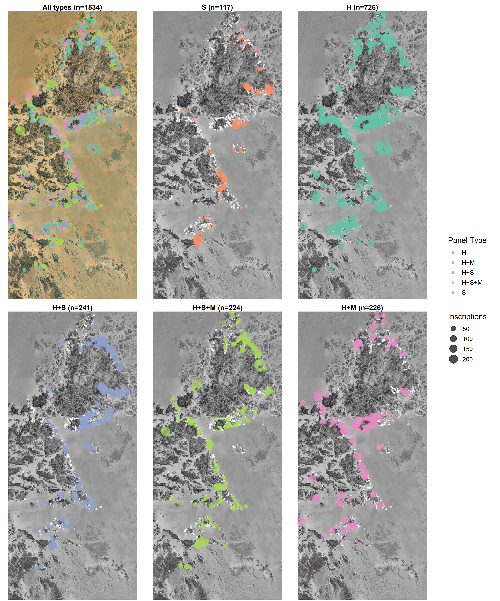
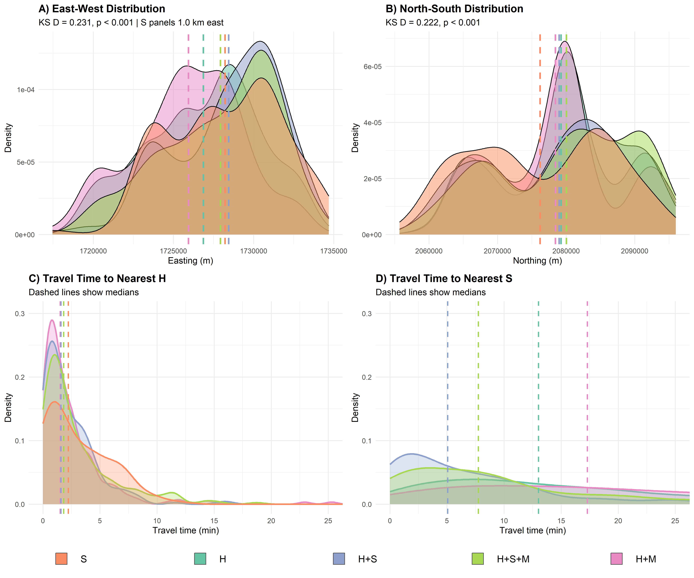
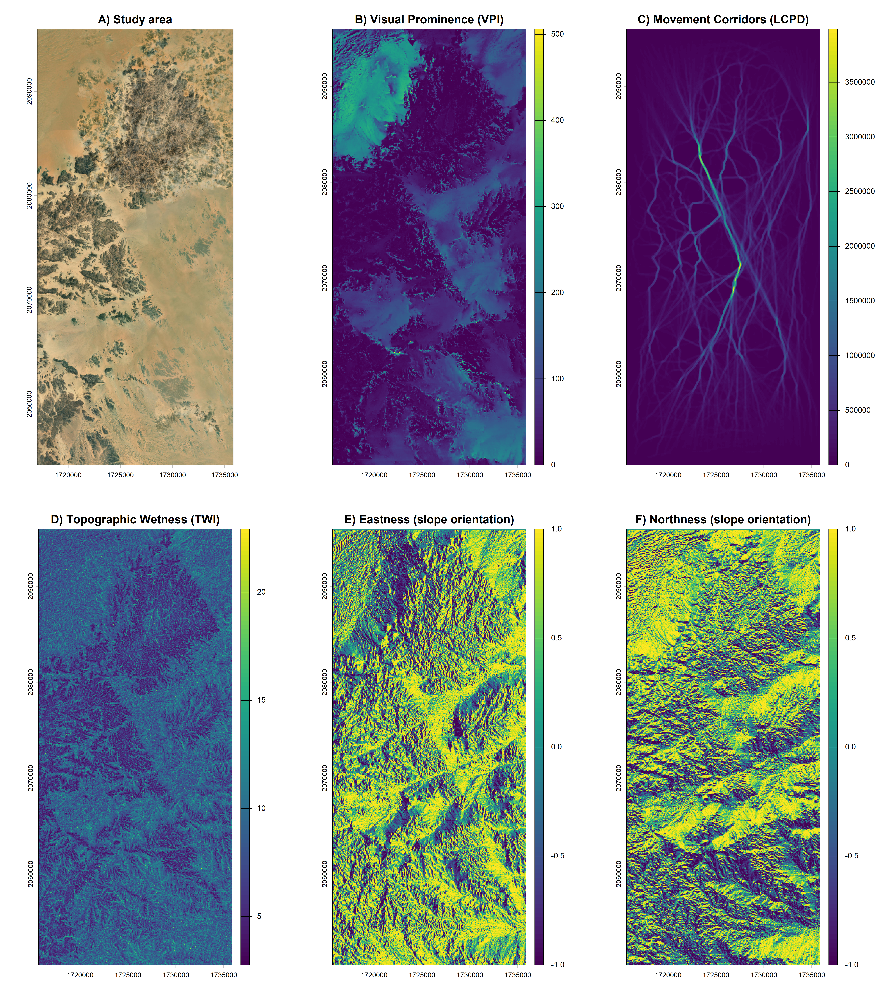
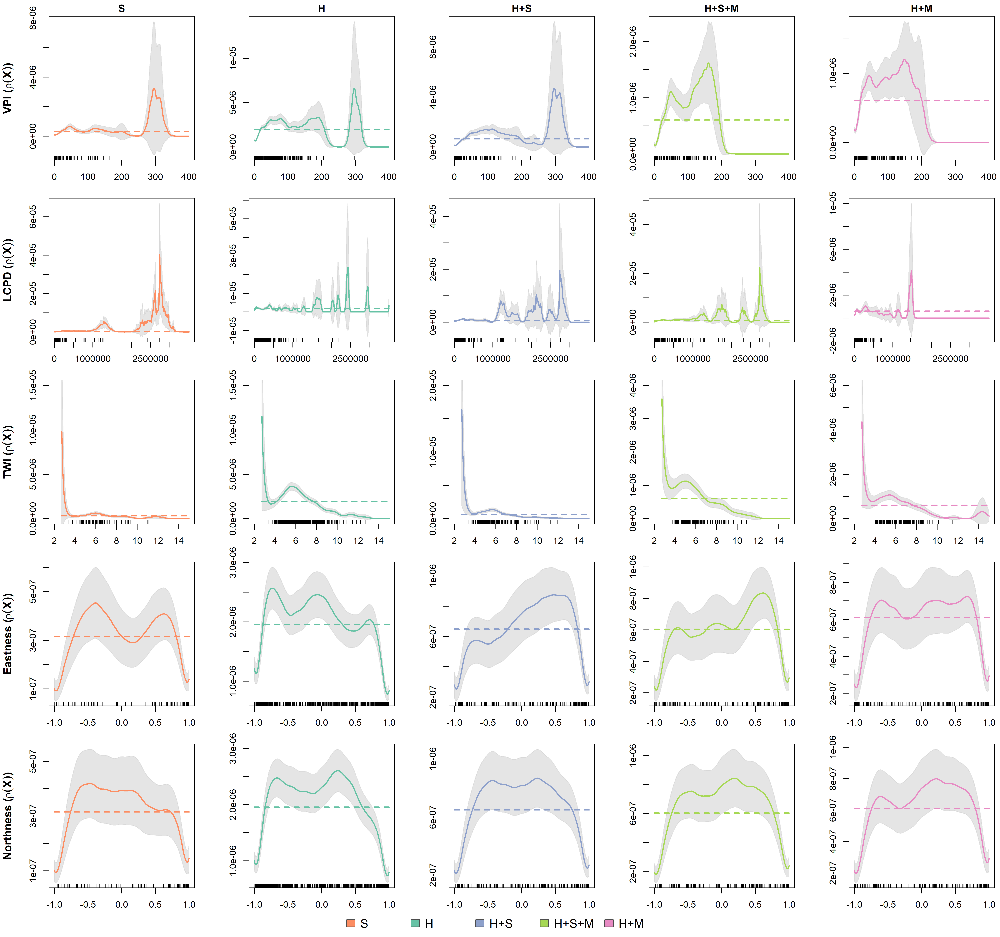
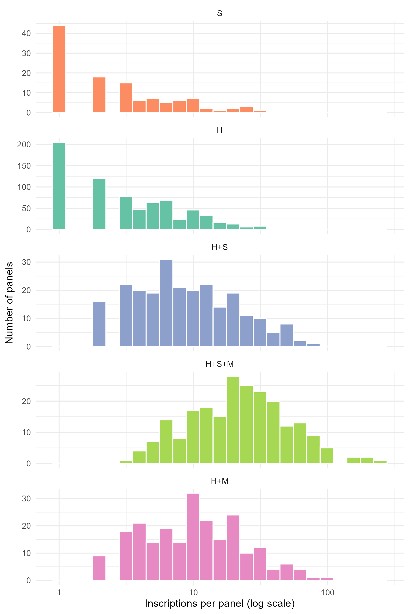
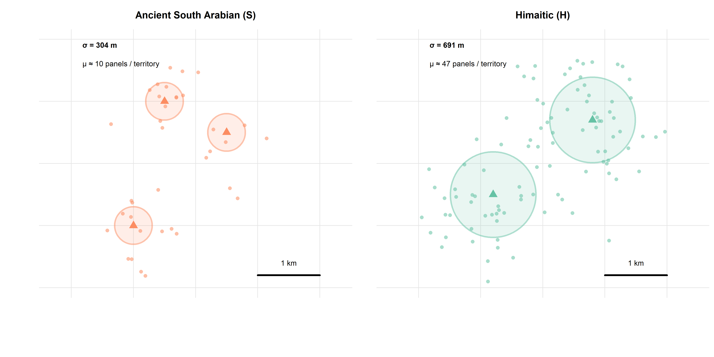
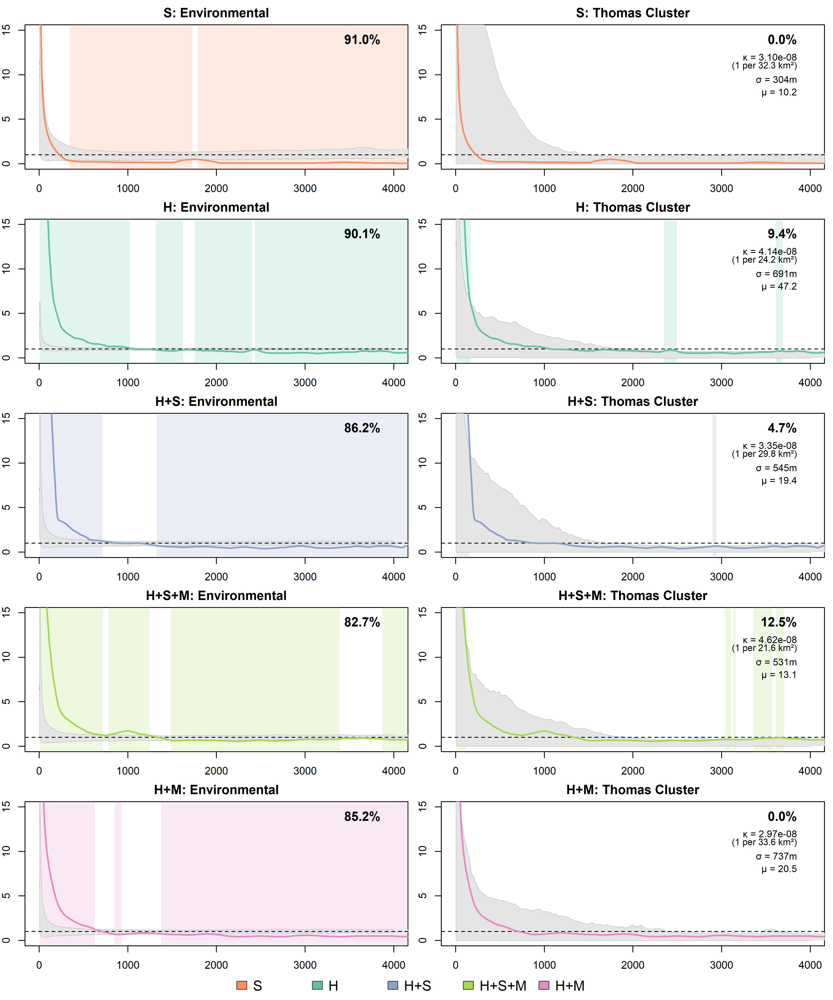
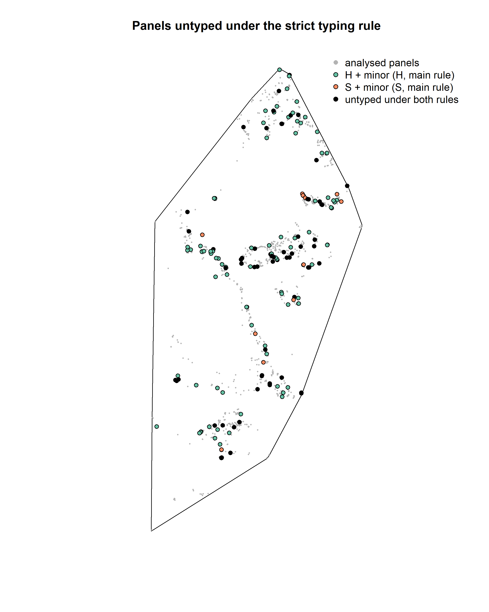
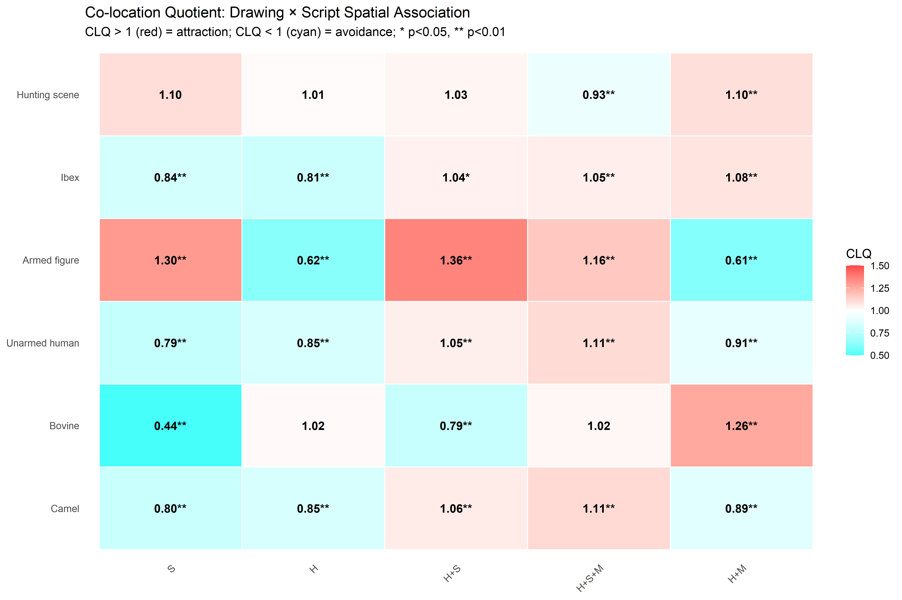

# Part 0: Setup and data loading

```{r setup}
#| label: setup

library(sf)
library(spatstat)
library(spatstat.explore)
library(spatstat.model)
library(spatstat.geom)
library(terra)
library(tidyverse)
library(gridExtra)
library(knitr)
library(kableExtra)
library(scales)
library(maptiles)  # not used
library(Hmisc)  # not used
library(corrplot)  # not used
library(UpSetR)
library(grid)

# R default; warnings are hidden in the rendered report (execute: warning: false)
options(warn = 0)
sf_use_s2(FALSE)

theme_set(theme_minimal(base_size = 11))

# Ensure figures output directory exists
dir.create("figures", showWarnings = FALSE)
custom_colors <- c(
  "S" = "#fc8d62",
  "H" = "#66c2a5",
  "H+S" = "#8da0cb",
  "H+S+M" = "#a6d854",
  "H+M" = "#e78ac3",
  "Other" = "gray70"
)

# Standard order for panel types throughout the document
panel_type_order <- c("S", "H", "H+S", "H+S+M", "H+M")

# Rock art color (for non-epigraphic visualizations)
rock_art_color <- "#ff474c"
```

```{r load-data}
#| label: load-data

# Input files (folder input/, see README.md); all in EPSG:32636 (UTM zone 36N), metres.
# - hima_aoi_v2.gpkg: study area (AOI) polygon.
# - hima_db.gpkg: inscriptions, one point each (id_old, script, script_style, period_text, associated_drawing).
# - vpi.tif, twi.tif, aspect.tif: 30 m covariates from the Copernicus GLO-30 DEM, GRASS GIS 8.4.1.
# - lcpd_f.tif: least-cost path density (separate least-cost path script; see README.md).
# - elevation.tif: Copernicus GLO-30 DEM (30 m), for travel times.
# - rock_outcrops.gpkg: bedrock units of geologic map GM-79C (Greenwood 1985; Saudi Geological Survey).
# - satellite.tif: Esri World Imagery (zoom 14), display only.
# Records without a panel id are counted in the totals below but not in panel-level analyses.

# Load AOI polygon
aoi <- st_read('input/hima_aoi_v2.gpkg', quiet = TRUE)

# Load and filter epigraphic data to AOI
epi_raw <- st_read('input/hima_db.gpkg', quiet = TRUE)

epi <- epi_raw %>%
  filter(!st_is_empty(geom)) %>%
  st_intersection(aoi) %>%
  mutate(
    x = st_coordinates(.)[,1],
    y = st_coordinates(.)[,2]
  )

# Load covariates (eastness and northness are derived from aspect below)
cov_base <- c('twi', 'vpi', 'lcpd_f')
covariates <- rast(paste0('input/', cov_base, '.tif'))
names(covariates) <- cov_base

# Load aspect and calculate eastness and northness
aspect <- rast('input/aspect.tif')
# GRASS aspect is counter-clockwise from east (90 = north): cos = eastness, sin = northness
eastness <- cos(aspect * pi / 180)
names(eastness) <- "eastness"
northness <- sin(aspect * pi / 180)
names(northness) <- "northness"
# Aspect is undefined on edge DEM cells: set to 0 (no orientation) so all models use the same panels
eastness[is.na(eastness)] <- 0
northness[is.na(northness)] <- 0

# Add eastness and northness to covariates stack
covariates <- c(covariates, eastness, northness)

# All covariate names (used consistently for panel aggregation)
cov_files <- c('twi', 'vpi', 'lcpd_f', 'eastness', 'northness')

epi_coords <- st_coordinates(epi)
epi_cov <- terra::extract(covariates, epi_coords)
epi <- bind_cols(epi, epi_cov)

# Create panel ID from first two blocks of id_old (e.g., "BYD02.01.003" -> "BYD02.01")
epi <- epi %>%
  mutate(
    id_panel = case_when(
      is.na(id_old) ~ NA_character_,
      TRUE ~ str_extract(id_old, "^[^\\.]+\\.[^\\.]+")
    ),
    # Any non-empty associated_drawing counts, including non-figural marks (e.g. Symbol, Monogram, Cross)
    has_drawing = !is.na(associated_drawing) & associated_drawing != "",
    drawing_type = associated_drawing
  )

# Summary statistics
cat(sprintf("Loaded %d inscriptions from %d unique panels\n",
            nrow(epi), 
            n_distinct(epi$id_panel[!is.na(epi$id_panel)])))

cat(sprintf("Inscriptions with documented drawings: %d (%.1f%%)\n",
            sum(epi$has_drawing, na.rm=TRUE),
            100*mean(epi$has_drawing, na.rm=TRUE)))

cat(sprintf("Inscriptions per panel (median): %.1f\n", 
            median(table(epi$id_panel[!is.na(epi$id_panel)]))))
```

# Part 1: Panel composition

## 1.1 Panel-level data

Script codes: S = Ancient South Arabian, H = Himaitic, M = Mixed (H and S features in one text); minor or unidentified: A = Arabic, U = unidentified, T, X, N, Sy, He, Na. Panels are typed by the major scripts (H, S, M) only; panels with M but no H, or with minor scripts only, are "Other".

```{r panel-aggregation}
#| label: panel-aggregation

# Create SPATIAL version first (for the point-pattern analyses from Part 2 on)
panels_sf <- epi %>%
  filter(!is.na(id_panel)) %>%
  group_by(id_panel) %>%
  summarise(
    n_inscriptions = n(),
    scripts = paste(sort(unique(script)), collapse = ","),
    n_scripts = n_distinct(script),
    has_H = any(script == "H"),
    has_S = any(script == "S"),
    has_A = any(script == "A"),
    has_M = any(script == "M"),
    # ^ anchors the match at the start, so "Informal" is never counted as "Formal"
    n_formal = sum(grepl("^Formal", script_style, ignore.case = TRUE)),
    n_informal = sum(grepl("^Informal", script_style, ignore.case = TRUE)),
    prop_formal = n_formal / n_inscriptions,
    n_periods = n_distinct(period_text[period_text != "undefined" & !is.na(period_text)]),
    # All inscriptions of a panel share one location, so first() gives the panel location
    x = first(x),
    y = first(y),
    across(all_of(cov_files), ~mean(.x, na.rm = TRUE)),
    geometry = first(geom),  # KEEP GEOMETRY for spatial operations
    .groups = "drop"
  ) %>%
  mutate(
    # Strict rule (H and S panels with no minor scripts), for the typing sensitivity check (Section 3.4.3)
    panel_type_submitted = case_when(
      n_scripts == 1 & has_H & !has_S & !has_M ~ "H",
      n_scripts == 1 & has_S & !has_H & !has_M ~ "S",
      has_H & has_S & has_M ~ "H+S+M",
      has_H & has_S & !has_M ~ "H+S",
      has_H & has_M & !has_S ~ "H+M",
      TRUE ~ "Other"),
    panel_type = case_when(
      # Main rule: major scripts only (H, S, M); 5 main categories for analysis
      has_H & !has_S & !has_M ~ "H",
      has_S & !has_H & !has_M ~ "S",
      has_H & has_S & has_M ~ "H+S+M",
      has_H & has_S & !has_M ~ "H+S",
      has_H & has_M & !has_S ~ "H+M",
      TRUE ~ "Other"
    )
  )

# Create non-spatial version for faster statistical operations
panels <- panels_sf %>% st_drop_geometry()
```

## 1.2 Script combinations (UpSet plot)

```{r upset-plot, fig.width=12, fig.height=6}
#| label: fig-upset
#| fig-cap: "Script Intersection Patterns (UpSet Plot)"

# Create presence-absence matrix for ALL scripts
all_scripts <- sort(unique(epi$script[!is.na(epi$script) & epi$script != ""]))

# Create panel-level presence-absence matrix
pam_data <- epi %>%
  filter(!is.na(id_panel), !is.na(script), script != "") %>%
  group_by(id_panel) %>%
  summarise(
    scripts_present = list(unique(script)),
    .groups = "drop"
  ) %>%
  mutate(presence = map(scripts_present, ~setNames(as.integer(all_scripts %in% .x), all_scripts))) %>%
  unnest_wider(presence) %>%
  select(-scripts_present)

# Create numeric presence-absence matrix
pam_numeric <- pam_data %>%
  select(all_of(all_scripts))
pam_numeric[] <- lapply(pam_numeric, as.integer)

# UpSet plot with colors matching custom_colors scheme
upset_data <- as.data.frame(pam_numeric)

upset(
  upset_data,
  nsets = length(all_scripts),
  nintersects = 25,
  order.by = "freq",
  sets.bar.color = "gray50",
  main.bar.color = "gray50",
  text.scale = c(1.5, 1.3, 1.2, 1, 1.5, 1.2),
  mb.ratio = c(0.6, 0.4),
  queries = list(
    # Single script categories
    list(query = intersects, params = list("H"), color = "#66c2a5", active = TRUE),
    list(query = intersects, params = list("S"), color = "#fc8d62", active = TRUE),
    # Multiscript categories - H+S (exactly H and S)
    list(query = intersects, params = list("H", "S"), color = "#8da0cb", active = TRUE),
    # H+S+M (H, S, and M together)
    list(query = intersects, params = list("H", "S", "M"), color = "#a6d854", active = TRUE),
    # H+M (exactly H and M)
    list(query = intersects, params = list("H", "M"), color = "#e78ac3", active = TRUE)
  )
)

cat(sprintf("Total scripts analyzed: %d\n", length(all_scripts)))
cat(sprintf("Scripts: %s\n\n", paste(all_scripts, collapse = ", ")))
```

## 1.3 Formal and informal script styles

Chi-squared tests compare the share of formal inscriptions on multiscript panels (H+S, H+S+M, H+M) with H-only and S-only panels. All typed panels are used, not only those in the outcrop window.

```{r formal-informal-analysis}
#| label: formal-informal

# Create a plain dataframe (no geometry) for analysis
epi_df <- as.data.frame(epi) %>%
  select(-geom) %>%
  mutate(style_simple = case_when(
    grepl("^Informal", script_style, ignore.case = TRUE) ~ "Informal",
    grepl("^Formal", script_style, ignore.case = TRUE) ~ "Formal",
    TRUE ~ NA_character_  # Exclude undefined from analysis
  ))

# Define panel type groups
h_panel_types <- c("H+S", "H+M", "H+S+M")

# Get baseline formal rates from H-only and S-only panels (types H and S)
h_only_ids <- panels %>% filter(panel_type == "H") %>% pull(id_panel)
h_baseline <- epi_df %>%
  filter(id_panel %in% h_only_ids, script == "H", !is.na(style_simple)) %>%
  summarise(n = n(), formal = sum(style_simple == "Formal"),
            informal = sum(style_simple == "Informal"), p_formal = formal / n)

s_only_ids <- panels %>% filter(panel_type == "S") %>% pull(id_panel)
s_baseline <- epi_df %>%
  filter(id_panel %in% s_only_ids, script == "S", !is.na(style_simple)) %>%
  summarise(n = n(), formal = sum(style_simple == "Formal"),
            informal = sum(style_simple == "Informal"), p_formal = formal / n)

# Get observed rates on multiscript panels (H+S, H+M, H+S+M)
mixed_ids <- panels %>% filter(panel_type %in% h_panel_types) %>% pull(id_panel)

h_mixed <- epi_df %>%
  filter(id_panel %in% mixed_ids, script == "H", !is.na(style_simple)) %>%
  summarise(n = n(), formal = sum(style_simple == "Formal"),
            informal = sum(style_simple == "Informal"), p_formal = formal / n)

s_mixed <- epi_df %>%
  filter(id_panel %in% mixed_ids, script == "S", !is.na(style_simple)) %>%
  summarise(n = n(), formal = sum(style_simple == "Formal"),
            informal = sum(style_simple == "Informal"), p_formal = formal / n)

# Chi-squared tests
h_matrix <- matrix(c(h_baseline$formal, h_baseline$informal,
                     h_mixed$formal, h_mixed$informal), nrow = 2, byrow = TRUE)
h_test <- chisq.test(h_matrix)

s_matrix <- matrix(c(s_baseline$formal, s_baseline$informal,
                     s_mixed$formal, s_mixed$informal), nrow = 2, byrow = TRUE)
s_test <- chisq.test(s_matrix)

# Get total inscription counts for context
total_H_only <- epi_df %>% filter(id_panel %in% h_only_ids, script == "H") %>% nrow()
total_H_mixed <- epi_df %>% filter(id_panel %in% mixed_ids, script == "H") %>% nrow()
total_S_only <- epi_df %>% filter(id_panel %in% s_only_ids, script == "S") %>% nrow()
total_S_mixed <- epi_df %>% filter(id_panel %in% mixed_ids, script == "S") %>% nrow()

# Output results
cat("=== Chi-squared test: share of formal inscriptions, multiscript vs H-only / S-only panels ===\n\n")

cat("H Script:\n")
cat(sprintf("  Baseline (H-only panels): %.2f%% formal (of %d inscriptions with style data; %d in total)\n",
            h_baseline$p_formal * 100, h_baseline$n, total_H_only))
cat(sprintf("  Observed (multiscript panels):  %.2f%% formal (of %d inscriptions with style data; %d in total)\n",
            h_mixed$p_formal * 100, h_mixed$n, total_H_mixed))
cat(sprintf("  Chi-squared test: X² = %.2f, p = %.4f\n", h_test$statistic, h_test$p.value))

cat("\nS Script:\n")
cat(sprintf("  Baseline (S-only panels): %.2f%% formal (of %d inscriptions with style data; %d in total)\n",
            s_baseline$p_formal * 100, s_baseline$n, total_S_only))
cat(sprintf("  Observed (multiscript panels):  %.2f%% formal (of %d inscriptions with style data; %d in total)\n",
            s_mixed$p_formal * 100, s_mixed$n, total_S_mixed))
cat(sprintf("  Chi-squared test: X² = %.2f, p = %.4f\n", s_test$statistic, s_test$p.value))
```

H inscriptions on multiscript panels are significantly more formal than on H-only panels; S inscriptions are almost always formal (~98%) on all panel types.

# Part 2: Exploratory spatial analysis

## 2.1 Point patterns and observation window

```{r ppp-setup}
#| label: ppp-setup

# Create point patterns for formal spatial analysis

# 5 main categories for analysis (standard order)
main_categories <- panel_type_order

panels_major <- panels %>%
  filter(panel_type %in% main_categories)

panels_major_sf <- panels_sf %>%
  filter(panel_type %in% main_categories)

coords_major <- panels_major_sf %>% select(x, y, panel_type) %>% st_drop_geometry()

# Define study window using ripras (Ripley-Rasson estimator)

# Create temporary point pattern with AOI window for ripras
W_temp <- as.owin(aoi)
ppp_temp <- ppp(x = coords_major$x, y = coords_major$y, window = W_temp)

# Compute ripras window
W <- ripras(ppp_temp)

cat(sprintf("  Original AOI area: %.2f km²\n", spatstat.geom::area.owin(W_temp) / 1e6))
cat(sprintf("  Ripras area: %.2f km²\n", spatstat.geom::area.owin(W) / 1e6))
cat(sprintf("  Reduction: %.1f%%\n\n", 100 * (1 - spatstat.geom::area.owin(W)/spatstat.geom::area.owin(W_temp))))

# Outcrop window = Ripras window ∩ bedrock units (sandstone, rhyolite, granite) + 500 m buffer,
# simplified by 50 m to keep PCF envelopes fast; panels outside it are excluded.
W_ripras <- W
rock_outcrops <- st_read('input/rock_outcrops.gpkg', quiet = TRUE)
outcrop_zone <- st_simplify(st_union(st_buffer(rock_outcrops, 500, nQuadSegs = 4)), dTolerance = 50)
W_outcrops <- as.owin(outcrop_zone)
W <- intersect.owin(W_ripras, W_outcrops)
in_window <- inside.owin(coords_major$x, coords_major$y, W)
cat(sprintf("  Outcrop window (Ripras ∩ rock outcrops + 500 m): %.2f km² (%.0f%% of Ripras)\n",
            spatstat.geom::area.owin(W) / 1e6, 100 * spatstat.geom::area.owin(W) / spatstat.geom::area.owin(W_ripras)))
cat(sprintf("  Panels inside the outcrop window: %d of %d (%.1f%%)\n\n",
            sum(in_window), length(in_window), 100 * mean(in_window)))
coords_major_ripras <- coords_major   # all main-type panels, kept for the window comparison (Section 3.4.1)
panels_major    <- panels_major[in_window, ]
panels_major_sf <- panels_major_sf[in_window, ]
coords_major    <- coords_major[in_window, ]

# Marked point pattern in the outcrop window
ppp_marked <- ppp(
  x = coords_major$x,
  y = coords_major$y,
  window = W,
  marks = factor(coords_major$panel_type, levels = panel_type_order)
)

# Create separate point patterns for each panel type
ppp_H <- ppp_marked[marks(ppp_marked) == "H"]
ppp_S <- ppp_marked[marks(ppp_marked) == "S"]
ppp_HS <- ppp_marked[marks(ppp_marked) == "H+S"]
ppp_HM <- ppp_marked[marks(ppp_marked) == "H+M"]
ppp_HSM <- ppp_marked[marks(ppp_marked) == "H+S+M"]

cat(sprintf("Created point patterns for spatial analysis:\n"))
cat(sprintf("  H:       %d panels\n", npoints(ppp_H)))
cat(sprintf("  S:       %d panels\n", npoints(ppp_S)))
cat(sprintf("  H+S:     %d panels\n", npoints(ppp_HS)))
cat(sprintf("  H+M:     %d panels\n", npoints(ppp_HM)))
cat(sprintf("  H+S+M:   %d panels\n", npoints(ppp_HSM)))

cat("\nNote: Panel counts here differ from the UpSet plot because (1) all panel types\n")
cat("ignore the minor and unidentified scripts (A, He, N, Na, Sy, T, U, X); e.g. 'H'\n")
cat("includes H+A panels, while the UpSet plot shows exact script combinations; and\n")
cat("(2) only panels inside the outcrop window are kept here.\n")
```

```{r window-comparison, fig.width=10, fig.height=5}
#| label: fig-window-comparison
#| fig-cap: "Study Window Comparison: Original AOI vs analysis window (Ripras ∩ outcrops)"

par(mfrow = c(1, 2), mar = c(3, 3, 3, 1))

# Left: Original AOI window
plot(W_temp, main = "A) Original AOI Window",
     cex.main = 0.9, font.main = 2)
points(ppp_temp, pch = 16, cex = 0.3, col = "#00000050")


# Right: outcrop window (Ripras ∩ rock outcrops + 500 m; dashed = Ripras alone)
plot(W, main = "B) Analysis window: Ripras ∩ rock outcrops + 500 m",
     cex.main = 0.9, font.main = 2, col = "tan", border = NA)
plot(W_ripras, add = TRUE, border = "grey40", lty = 2)
points(ppp_marked, pch = 16, cex = 0.3, col = "#00000050")
```

## 2.2 Spatial distribution of panel types

```{r spatial-overview, fig.width=10, fig.height=12}
#| label: fig-spatial-overview
#| fig-cap: "Spatial Distribution of Panel Types, panels in the outcrop window (paper Figure 3)"

# Save to file at 400 dpi
png("figures/Figure_1_spatial_distribution.png", width = 10, height = 12, units = "in", res = 400, pointsize = 10)

# Load satellite image (Esri World Imagery; display only)
sat <- rast("input/satellite.tif")
ext_sat <- ext(sat)

# Convert raster to RGB array for annotation_raster
sat_rgb <- as.array(sat)
sat_rgb[is.na(sat_rgb)] <- 0
sat_rgb <- sat_rgb / 255
sat_rgb[sat_rgb < 0] <- 0
sat_rgb[sat_rgb > 1] <- 1

# No lightening: sat_rgb_light is an alias of sat_rgb
sat_rgb_light <- sat_rgb

# Create grayscale version for individual plots (no lightening)
sat_gray <- 0.299 * sat_rgb[,,1] + 0.587 * sat_rgb[,,2] + 0.114 * sat_rgb[,,3]
sat_bw <- array(dim = dim(sat_rgb))
sat_bw[,,1] <- sat_gray
sat_bw[,,2] <- sat_gray
sat_bw[,,3] <- sat_gray

# Helper function to create plots - all identical structure, no axis labels
make_type_plot <- function(ptype, use_color = FALSE) {
  n_panels <- sum(panels_major$panel_type == ptype)

  p <- ggplot() +
    annotation_raster(if(use_color) sat_rgb_light else sat_bw,
                      xmin = ext_sat[1], xmax = ext_sat[2],
                      ymin = ext_sat[3], ymax = ext_sat[4]) +
    geom_point(data = panels_major %>% filter(panel_type != ptype),
               aes(x = x, y = y), color = "white", size = 0.5, alpha = 0.5) +
    geom_point(data = panels_major %>% filter(panel_type == ptype),
               aes(x = x, y = y, size = n_inscriptions),
               color = custom_colors[ptype], alpha = 0.7) +
    scale_size_continuous(range = c(1, 6), guide = "none") +
    coord_fixed(xlim = c(ext_sat[1], ext_sat[2]),
                ylim = c(ext_sat[3], ext_sat[4]), expand = FALSE) +
    labs(x = NULL, y = NULL, title = sprintf("%s (n=%d)", ptype, n_panels)) +
    theme_void(base_size = 9) +
    theme(plot.title = element_text(hjust = 0.5, face = "bold", size = 10),
          plot.margin = margin(2, 2, 2, 2))
  return(p)
}

# Create "All types" plot (top-left, color satellite)
p_all <- ggplot() +
  annotation_raster(sat_rgb_light,
                    xmin = ext_sat[1], xmax = ext_sat[2],
                    ymin = ext_sat[3], ymax = ext_sat[4]) +
  geom_point(data = panels_major,
             aes(x = x, y = y, color = panel_type, size = n_inscriptions),
             alpha = 0.7) +
  scale_color_manual(values = custom_colors, name = "Panel Type") +
  scale_size_continuous(range = c(1, 6), name = "Inscriptions") +
  coord_fixed(xlim = c(ext_sat[1], ext_sat[2]),
              ylim = c(ext_sat[3], ext_sat[4]), expand = FALSE) +
  labs(x = NULL, y = NULL, title = sprintf("All types (n=%d)", nrow(panels_major))) +
  theme_void(base_size = 9) +
  theme(plot.title = element_text(hjust = 0.5, face = "bold", size = 10),
        plot.margin = margin(2, 2, 2, 2),
        legend.position = "none")

# Create the 5 per-type plots
p_H <- make_type_plot("H")
p_S <- make_type_plot("S")
p_HS <- make_type_plot("H+S")
p_HM <- make_type_plot("H+M")
p_HSM <- make_type_plot("H+S+M")

# Create legend from a dummy plot
legend_plot <- ggplot(panels_major, aes(x = x, y = y, color = panel_type, size = n_inscriptions)) +
  geom_point(alpha = 0.7) +
  scale_color_manual(values = custom_colors, name = "Panel Type") +
  scale_size_continuous(range = c(1, 6), name = "Inscriptions") +
  guides(color = guide_legend(order = 1), size = guide_legend(order = 2)) +
  theme_minimal() +
  theme(legend.position = "right",
        legend.direction = "vertical",
        legend.box = "vertical")

# Extract legend
get_legend <- function(p) {
  tmp <- ggplot_gtable(ggplot_build(p))
  leg <- which(sapply(tmp$grobs, function(x) x$name) == "guide-box")
  if(length(leg) > 0) tmp$grobs[[leg]] else NULL
}
shared_legend <- get_legend(legend_plot)

# Arrange: 2x3 grid + legend on the right
# Row 1: All types (satellite), S, H
# Row 2: H+S, H+S+M, H+M
grid.arrange(
  arrangeGrob(p_all, p_S, p_H, p_HS, p_HSM, p_HM, ncol = 3, nrow = 2),
  shared_legend,
  ncol = 2,
  widths = c(10, 1.5)
)
dev.off()
cat("Saved: figures/Figure_1_spatial_distribution.png (400 dpi)\n")

```

```{r spatial-overview-1row, fig.width=16, fig.height=5, eval=FALSE}
#| label: fig-spatial-overview-1row
#| fig-cap: "Spatial Distribution of Panel Types (single row)"

# Create horizontal legend for bottom placement
legend_plot_h <- ggplot(panels_major, aes(x = x, y = y, color = panel_type, size = n_inscriptions)) +
  geom_point(alpha = 0.7) +
  scale_color_manual(values = custom_colors, name = "Panel Type") +
  scale_size_continuous(range = c(1, 6), name = "Inscriptions") +
  guides(color = guide_legend(nrow = 1), size = guide_legend(nrow = 1)) +
  theme_minimal() +
  theme(legend.position = "bottom",
        legend.direction = "horizontal",
        legend.box = "horizontal")
shared_legend_h <- get_legend(legend_plot_h)

# Single row version for presentations with legend at bottom
grid.arrange(
  arrangeGrob(p_S, p_HS, p_H, p_HM, p_HSM, p_all, ncol = 6, nrow = 1),
  shared_legend_h,
  nrow = 2,
  heights = c(10, 1)
)
```

## 2.3 East-west and north-south shifts

Kolmogorov-Smirnov tests compare the easting and northing of H and S panels.

```{r ks-tests}
#| label: ks-tests

h_only <- panels_major %>% filter(panel_type == "H")
s_only <- panels_major %>% filter(panel_type == "S")

ks_ew <- ks.test(h_only$x, s_only$x)
diff_ew <- median(s_only$x) - median(h_only$x)

ks_ns <- ks.test(h_only$y, s_only$y)
diff_ns <- median(s_only$y) - median(h_only$y)

cat("Directional Distribution Patterns (Kolmogorov-Smirnov Tests):\n")
cat("==============================================================\n\n")
cat("These tests characterize the DIRECTION of spatial separation.\n\n")
cat(sprintf("E-W (Easting): D = %.3f, p = %.2g\n", ks_ew$statistic, ks_ew$p.value))
cat(sprintf("  → S panels are %.0f m (%.2f km) further EAST\n", diff_ew, diff_ew/1000))
cat(sprintf("\nN-S (Northing): D = %.3f, p = %.4f\n", ks_ns$statistic, ks_ns$p.value))
cat(sprintf("  → Median northing, S minus H: %.0f m (%.2f km), i.e. S panels lie further %s\n", diff_ns, diff_ns/1000, ifelse(diff_ns < 0, "SOUTH", "NORTH")))
```

## 2.4 Nearest-neighbour distances and travel times

```{r nearest-neighbor-distances}
#| label: nn-distances

# Calculate nearest-neighbor distances between panel types
nn_H_to_S <- nncross(ppp_H, ppp_S)
nn_S_to_H <- nncross(ppp_S, ppp_H)
nn_HS_to_H <- nncross(ppp_HS, ppp_H)
nn_HS_to_S <- nncross(ppp_HS, ppp_S)

# Also calculate for H+M and H+S+M if they have sufficient points
if(npoints(ppp_HM) >= 5) {
  nn_HM_to_H <- nncross(ppp_HM, ppp_H)
  nn_HM_to_S <- nncross(ppp_HM, ppp_S)
}
if(npoints(ppp_HSM) >= 5) {
  nn_HSM_to_H <- nncross(ppp_HSM, ppp_H)
  nn_HSM_to_S <- nncross(ppp_HSM, ppp_S)
}

cat("NEAREST-NEIGHBOR DISTANCES BETWEEN PANEL TYPES\n")
cat("===============================================\n\n")

cat("H to nearest S:\n")
cat(sprintf("  Median: %.0f m\n", median(nn_H_to_S$dist)))
cat(sprintf("  Mean: %.0f m\n", mean(nn_H_to_S$dist)))
cat(sprintf("  Range: %.0f - %.0f m\n", min(nn_H_to_S$dist), max(nn_H_to_S$dist)))

cat("\nS to nearest H:\n")
cat(sprintf("  Median: %.0f m\n", median(nn_S_to_H$dist)))
cat(sprintf("  Mean: %.0f m\n", mean(nn_S_to_H$dist)))
cat(sprintf("  Range: %.0f - %.0f m\n", min(nn_S_to_H$dist), max(nn_S_to_H$dist)))

cat("\nH+S to nearest H:\n")
cat(sprintf("  Median: %.0f m\n", median(nn_HS_to_H$dist)))
cat(sprintf("  Mean: %.0f m\n", mean(nn_HS_to_H$dist)))

cat("\nH+S to nearest S:\n")
cat(sprintf("  Median: %.0f m\n", median(nn_HS_to_S$dist)))
cat(sprintf("  Mean: %.0f m\n", mean(nn_HS_to_S$dist)))

if(exists("nn_HM_to_H")) {
  cat("\nH+M to nearest H:\n")
  cat(sprintf("  Median: %.0f m\n", median(nn_HM_to_H$dist)))
  cat("\nH+M to nearest S:\n")
  cat(sprintf("  Median: %.0f m\n", median(nn_HM_to_S$dist)))
}

if(exists("nn_HSM_to_H")) {
  cat("\nH+S+M to nearest H:\n")
  cat(sprintf("  Median: %.0f m\n", median(nn_HSM_to_H$dist)))
  cat("\nH+S+M to nearest S:\n")
  cat(sprintf("  Median: %.0f m\n", median(nn_HSM_to_S$dist)))
}

hs_distance_ratio <- median(nn_HS_to_S$dist) / median(nn_HS_to_H$dist)

cat(sprintf("\n-> H+S panels are %.1fx closer to H panels than to S panels\n", hs_distance_ratio))
cat("  (ratio of median Euclidean distances; travel-time ratios are computed below),\n")
cat("  i.e. H+S panels lie within H-dominated zones, not S-dominated zones.\n")

# Store medians (not used later)
nn_HS_to_H_median <- median(nn_HS_to_H$dist)
nn_HS_to_S_median <- median(nn_HS_to_S$dist)

# Nearest-neighbour least-cost travel times (minutes); same cost surface as the LCPD covariate
# (Tobler hiking function, slope exaggeration, 16 neighbours). Packages not on CRAN: see README.md.
library(leastcostpathDEV)
library(cppRouting)
dem_tt <- rast('input/elevation.tif')
cs_tt <- create_slope_cs(x = dem_tt, cost_function = "tobler", neighbours = 16, exaggeration = TRUE)
tt_nearest <- function(X_from, X_to) {   # minutes from each panel in X_from to the nearest panel in X_to (edge costs in seconds)
  cells <- function(X) as.character(terra::cellFromXY(dem_tt, cbind(X$x, X$y)))
  from_cells <- cells(X_from); from_u <- unique(from_cells)
  m <- get_distance_matrix(cs_tt$cppRoutingGraph, from = from_u, to = unique(cells(X_to)))
  (apply(m, 1, min, na.rm = TRUE) / 60)[match(from_cells, from_u)]
}
tt_H_to_S <- tt_nearest(ppp_H, ppp_S);     tt_S_to_H <- tt_nearest(ppp_S, ppp_H)
tt_HS_to_H <- tt_nearest(ppp_HS, ppp_H);   tt_HS_to_S <- tt_nearest(ppp_HS, ppp_S)
tt_HM_to_H <- tt_nearest(ppp_HM, ppp_H);   tt_HM_to_S <- tt_nearest(ppp_HM, ppp_S)
tt_HSM_to_H <- tt_nearest(ppp_HSM, ppp_H); tt_HSM_to_S <- tt_nearest(ppp_HSM, ppp_S)
cat("\nTRAVEL TIME TO THE NEAREST PANEL (median, minutes)\n")
print(round(sapply(list(`H+S -> H` = tt_HS_to_H, `H+S -> S` = tt_HS_to_S,
                        `H+S+M -> H` = tt_HSM_to_H, `H+S+M -> S` = tt_HSM_to_S,
                        `H+M -> H` = tt_HM_to_H, `H+M -> S` = tt_HM_to_S,
                        `S -> H` = tt_S_to_H, `H -> S` = tt_H_to_S), median), 1))
```

Median distances to the nearest panel of each type, Euclidean and as least-cost travel time (paper Table 1).

```{r travel-time}
#| label: travel-time

# leastcostpathDEV 2.0.12 (not on CRAN) and cppRouting 4.0 (GitHub): see README.md
library(leastcostpathDEV)
library(cppRouting)

dem <- rast('input/elevation.tif')
cs_tobler <- create_slope_cs(x = dem, cost_function = "tobler", neighbours = 16, exaggeration = TRUE)

# Travel time (minutes) from each panel in X_from to the nearest panel in X_to.
# The graph's nodes are DEM cells and its edge costs are seconds.
cell_id <- function(X) as.character(terra::cellFromXY(dem, cbind(X$x, X$y)))
nearest_time <- function(X_from, X_to) {
  from_cells <- cell_id(X_from)
  from_u <- unique(from_cells)
  m <- get_distance_matrix(cs_tobler$cppRoutingGraph, from = from_u, to = unique(cell_id(X_to)))
  (apply(m, 1, min, na.rm = TRUE) / 60)[match(from_cells, from_u)]
}

pp_type <- function(t) ppp_marked[marks(ppp_marked) == t]
tt_pairs <- list(c("H+S", "H"), c("H+S", "S"), c("H+S+M", "H"), c("H+S+M", "S"),
                 c("H+M", "H"), c("H+M", "S"), c("S", "H"), c("H", "S"))
tt_table <- map_dfr(tt_pairs, function(p) {
  tibble(Source = p[1], Target = p[2],
         `Median Euclidean (m)` = median(nncross(pp_type(p[1]), pp_type(p[2]))$dist),
         `Median travel time (min)` = median(nearest_time(pp_type(p[1]), pp_type(p[2]))))
})
kable(tt_table, digits = 1, caption = "Nearest-neighbour distances: Euclidean vs travel time")

# Ratio: distance to nearest S / distance to nearest H, for the multiscript types
tt_ratios <- tt_table %>%
  filter(Source %in% c("H+S", "H+S+M", "H+M")) %>%
  group_by(Source) %>%
  summarise(`Ratio Euclidean (to S / to H)` = `Median Euclidean (m)`[Target == "S"] / `Median Euclidean (m)`[Target == "H"],
            `Ratio travel time (to S / to H)` = `Median travel time (min)`[Target == "S"] / `Median travel time (min)`[Target == "H"])
kable(tt_ratios, digits = 1)
```

## 2.5 Segregation figure

```{r spatial-viz-integrated, fig.width=12, fig.height=10}
#| label: fig-spatial-integrated
#| fig-cap: "Integrated Spatial Segregation Analysis (paper Figure 5)"

# Save to file at 400 dpi
png("figures/Figure_2_spatial_segregation.png", width = 12, height = 10, units = "in", res = 400, pointsize = 12)

# Type means (dashed lines in A-B); "km east" in A is the difference of medians (ks-tests chunk)
centroids <- panels_major %>%
  group_by(panel_type) %>%
  summarise(x_mean = mean(x), y_mean = mean(y), .groups = "drop")

# A) East-West distribution
p1 <- ggplot(panels_major, aes(x = x, fill = panel_type)) +
  geom_density(alpha = 0.5) +
  geom_vline(data = centroids, aes(xintercept = x_mean, color = panel_type),
             linewidth = 1, linetype = "dashed") +
  scale_fill_manual(values = custom_colors) +
  scale_color_manual(values = custom_colors) +
  labs(x = "Easting (m)", y = "Density",
       title = "A) East-West Distribution",
       subtitle = sprintf("KS D = %.3f, %s | S panels %.1f km east",
                         ks_ew$statistic, ifelse(ks_ew$p.value < 0.001, "p < 0.001", sprintf("p = %.3f", ks_ew$p.value)), diff_ew/1000)) +
  theme_minimal(base_size = 11) +
  theme(legend.position = "none",
        plot.title = element_text(face = "bold"))

# B) North-South distribution
p2 <- ggplot(panels_major, aes(x = y, fill = panel_type)) +
  geom_density(alpha = 0.5) +
  geom_vline(data = centroids, aes(xintercept = y_mean, color = panel_type),
             linewidth = 1, linetype = "dashed") +
  scale_fill_manual(values = custom_colors) +
  scale_color_manual(values = custom_colors) +
  labs(x = "Northing (m)", y = "Density",
       title = "B) North-South Distribution",
       subtitle = sprintf("KS D = %.3f, %s", ks_ns$statistic,
                          ifelse(ks_ns$p.value < 0.001, "p < 0.001", sprintf("p = %.3f", ks_ns$p.value)))) +
  theme_minimal(base_size = 11) +
  theme(legend.position = "none",
        plot.title = element_text(face = "bold"))

# C-D: least-cost travel times (minutes) to the nearest H and to the nearest S panel
nn_dist_data <- bind_rows(
  tibble(comparison = "H → S", distance = tt_H_to_S),
  tibble(comparison = "S → H", distance = tt_S_to_H),
  tibble(comparison = "H+S → H", distance = tt_HS_to_H),
  tibble(comparison = "H+S → S", distance = tt_HS_to_S)
)

# Add H+M and H+S+M if available
if(exists("nn_HM_to_H")) {
  nn_dist_data <- bind_rows(nn_dist_data,
    tibble(comparison = "H+M → H", distance = tt_HM_to_H),
    tibble(comparison = "H+M → S", distance = tt_HM_to_S))
}
if(exists("nn_HSM_to_H")) {
  nn_dist_data <- bind_rows(nn_dist_data,
    tibble(comparison = "H+S+M → H", distance = tt_HSM_to_H),
    tibble(comparison = "H+S+M → S", distance = tt_HSM_to_S))
}

# Add source and target columns
nn_dist_data <- nn_dist_data %>%
  mutate(source = sub(" → .*", "", comparison),
         target = sub(".* → ", "", comparison))

# Calculate medians for vertical lines
nn_medians <- nn_dist_data %>%
  group_by(source, target) %>%
  summarise(med = median(distance), .groups = "drop")

# Common y-axis limits for C and D (y_max is not used; y_limit below is)
y_max <- max(
  layer_scales(ggplot(nn_dist_data %>% filter(target == "H"), aes(x = distance)) + geom_density())$y$range$range[2],
  layer_scales(ggplot(nn_dist_data %>% filter(target == "S"), aes(x = distance)) + geom_density())$y$range$range[2]
)

# Build both plots to get y limits
p3_build <- ggplot_build(ggplot(nn_dist_data %>% filter(target == "H"), aes(x = distance, color = source, fill = source)) + geom_density(alpha = 0.3))
p4_build <- ggplot_build(ggplot(nn_dist_data %>% filter(target == "S"), aes(x = distance, color = source, fill = source)) + geom_density(alpha = 0.3))
y_limit <- max(c(max(p3_build$data[[1]]$y), max(p4_build$data[[1]]$y)))

# C) Travel time to nearest H (minutes; x axis cut at 25 min, densities and medians use all values)
p3 <- ggplot(nn_dist_data %>% filter(target == "H"),
             aes(x = distance, color = source, fill = source)) +
  geom_density(alpha = 0.3, linewidth = 1) +
  geom_vline(data = nn_medians %>% filter(target == "H"),
             aes(xintercept = med, color = source),
             linetype = "dashed", linewidth = 0.8) +
  scale_color_manual(values = custom_colors) +
  scale_fill_manual(values = custom_colors) +
  coord_cartesian(xlim = c(0, 25), ylim = c(0, y_limit * 1.05)) +
  scale_x_continuous(labels = scales::comma) +
  labs(x = "Travel time (min)", y = "Density",
       title = "C) Travel Time to Nearest H",
       subtitle = "Dashed lines show medians") +
  theme_minimal(base_size = 11) +
  theme(legend.position = "none",
        plot.title = element_text(face = "bold"))

# D) Travel time to nearest S (as in C)
p4 <- ggplot(nn_dist_data %>% filter(target == "S"),
             aes(x = distance, color = source, fill = source)) +
  geom_density(alpha = 0.3, linewidth = 1) +
  geom_vline(data = nn_medians %>% filter(target == "S"),
             aes(xintercept = med, color = source),
             linetype = "dashed", linewidth = 0.8) +
  scale_color_manual(values = custom_colors) +
  scale_fill_manual(values = custom_colors) +
  coord_cartesian(xlim = c(0, 25), ylim = c(0, y_limit * 1.05)) +
  scale_x_continuous(labels = scales::comma) +
  labs(x = "Travel time (min)", y = "Density",
       title = "D) Travel Time to Nearest S",
       subtitle = "Dashed lines show medians") +
  theme_minimal(base_size = 11) +
  theme(legend.position = "none",
        plot.title = element_text(face = "bold"))

# Build manual legend row with colored boxes and labels using grid
legend_items <- lapply(panel_type_order, function(lbl) {
  arrangeGrob(
    rectGrob(gp = gpar(fill = custom_colors[lbl], col = "grey30"),
             width = unit(0.5, "cm"), height = unit(0.5, "cm")),
    textGrob(paste0("  ", lbl), hjust = 0, gp = gpar(fontsize = 12)),
    nrow = 1, widths = unit(c(0.5, 0.7), "cm")
  )
})
legend_row <- do.call(arrangeGrob, c(legend_items, list(ncol = length(panel_type_order))))

# Arrange 2x2 grid + legend at bottom
grid.arrange(
  arrangeGrob(p1, p2, p3, p4, ncol = 2, nrow = 2),
  legend_row,
  nrow = 2, heights = c(14, 1)
)
dev.off()
cat("Saved: figures/Figure_2_spatial_segregation.png (400 dpi)\n")

```

# Part 3: Point process models

## 3.1 Landscape covariates

### 3.1.1 Covariate preparation and maps

```{r convert-covariates-early}
#| label: convert-covariates-early

# Define theory-driven variables for analysis
theory_vars <- c('vpi', 'lcpd_f', 'twi', 'eastness')  # northness is added in the rhohat chunk (3.1.2)
key_covs <- theory_vars  # alias (not used)

# Get spatial extent and resolution from first raster
ext_rast <- ext(covariates[[1]])
first_mat <- as.matrix(covariates[[1]], wide = TRUE)
nr <- nrow(first_mat)
nc <- ncol(first_mat)

# Function to convert terra raster to spatstat im
raster_to_im <- function(rast, ext_rast, nr, nc, W) {
  mat <- as.matrix(rast, wide = TRUE)
  # Note: terra uses top-down orientation, spatstat uses bottom-up
  im_obj <- im(mat[nr:1, ],
               xcol = seq(ext_rast[1], ext_rast[2], length.out = nc),
               yrow = seq(ext_rast[3], ext_rast[4], length.out = nr))
  # Clip to study window
  im_obj[W, drop = FALSE]
}

# Convert selected covariates to im objects
covlist <- solist()
for (cov_name in theory_vars) {
  covlist[[cov_name]] <- raster_to_im(covariates[[cov_name]], ext_rast, nr, nc, W)
}
```

```{r plot-covariates, fig.width=15, fig.height=17}
#| label: fig-covariates-maps
#| fig-cap: "Study Area Satellite Image and Landscape Covariates (paper Figure 4)"

# Load satellite image from input folder
satellite_img <- rast("input/satellite.tif")

cat("Loaded satellite imagery from input/satellite.tif\n")

# 2 rows x 3 columns: satellite image + five covariates (windows are shown in Part 2.1)

# Save to file at 400 dpi
png("figures/Figure_3_study_area_covariates.png", width = 15, height = 17, units = "in", res = 400, pointsize = 18)

layout(matrix(1:6, nrow = 2, byrow = TRUE))
par(oma = c(0, 0, 0, 0))
mar_map <- c(3, 3, 2.5, 5)

# A) Satellite image (no colour stretch)
par(mar = mar_map)
plotRGB(satellite_img, r = 1, g = 2, b = 3, axes = TRUE, mar = mar_map)
title(main = "A) Study area", line = 0.5)

# B) VPI - Visual Prominence Index
plot(covariates[["vpi"]], main = "B) Visual Prominence (VPI)", axes = TRUE, mar = mar_map)

# C) LCPD - Movement Corridors (linear scale)
plot(covariates[["lcpd_f"]], main = "C) Movement Corridors (LCPD)", axes = TRUE, mar = mar_map)

# D) TWI - Topographic Wetness Index
plot(covariates[["twi"]], main = "D) Topographic Wetness (TWI)", axes = TRUE, mar = mar_map)

# E) Eastness (cos of GRASS aspect)
plot(covariates[["eastness"]], main = "E) Eastness (slope orientation)", axes = TRUE, mar = mar_map)

# F) Northness (sin of GRASS aspect)
plot(covariates[["northness"]], main = "F) Northness (slope orientation)", axes = TRUE, mar = mar_map)

par(mfrow = c(1, 1))
dev.off()
cat("Saved: figures/Figure_3_study_area_covariates.png (400 dpi)\n")

```

### 3.1.2 Intensity against each covariate (rhohat)

`rhohat` estimates how panel intensity varies with each covariate, before formal model fitting.

```{r rhohat-exploratory}
#| label: rhohat

# Add northness to covlist and theory_vars (all five covariates from here on)
covlist[["northness"]] <- raster_to_im(covariates[["northness"]], ext_rast, nr, nc, W)
theory_vars <- c(theory_vars, "northness")

cat("EXPLORATORY ANALYSIS: Rhohat (Intensity vs Covariates)\n")
cat("========================================================\n\n")
cat("Comparing 5 panel types: H, S, H+S, H+M, and H+S+M\n")
cat("Using 5 theory-driven environmental covariates:\n")
cat(paste("  -", names(covlist)), sep = "\n")
cat("\n")

# Ensure point patterns are unmarked (rhohat doesn't work with marked patterns)
ppp_H_unmarked <- unmark(ppp_H)
ppp_S_unmarked <- unmark(ppp_S)
ppp_HS_unmarked <- unmark(ppp_HS)
ppp_HM_unmarked <- unmark(ppp_HM)
ppp_HSM_unmarked <- unmark(ppp_HSM)

# Rhohat for H-only panels
rhohat_H_list <- list()
for(i in 1:length(covlist)) {
  tryCatch({
    rh <- rhohat(ppp_H_unmarked, covlist[[i]], confidence = 0.95)
    rhohat_H_list[[i]] <- rh
  }, error = function(e) {
    cat(sprintf("Warning: Could not compute rhohat for H-only, %s: %s\n",
                names(covlist)[i], e$message))
    rhohat_H_list[[i]] <<- NULL
  })
}
names(rhohat_H_list) <- names(covlist)

# Rhohat for S-only panels
rhohat_S_list <- list()
for(i in 1:length(covlist)) {
  tryCatch({
    rh <- rhohat(ppp_S_unmarked, covlist[[i]], confidence = 0.95)
    rhohat_S_list[[i]] <- rh
  }, error = function(e) {
    cat(sprintf("Warning: Could not compute rhohat for S-only, %s: %s\n",
                names(covlist)[i], e$message))
    rhohat_S_list[[i]] <<- NULL
  })
}
names(rhohat_S_list) <- names(covlist)

# Rhohat for H+S (multiscript) panels
rhohat_HS_list <- list()
for(i in 1:length(covlist)) {
  tryCatch({
    rh <- rhohat(ppp_HS_unmarked, covlist[[i]], confidence = 0.95)
    rhohat_HS_list[[i]] <- rh
  }, error = function(e) {
    cat(sprintf("Warning: Could not compute rhohat for H+S, %s: %s\n",
                names(covlist)[i], e$message))
    rhohat_HS_list[[i]] <<- NULL
  })
}
names(rhohat_HS_list) <- names(covlist)

# Rhohat for H+M panels
rhohat_HM_list <- list()
for(i in 1:length(covlist)) {
  tryCatch({
    rh <- rhohat(ppp_HM_unmarked, covlist[[i]], confidence = 0.95)
    rhohat_HM_list[[i]] <- rh
  }, error = function(e) {
    cat(sprintf("Warning: Could not compute rhohat for H+M, %s: %s\n",
                names(covlist)[i], e$message))
    rhohat_HM_list[[i]] <<- NULL
  })
}
names(rhohat_HM_list) <- names(covlist)

# Rhohat for H+S+M panels
rhohat_HSM_list <- list()
for(i in 1:length(covlist)) {
  tryCatch({
    rh <- rhohat(ppp_HSM_unmarked, covlist[[i]], confidence = 0.95)
    rhohat_HSM_list[[i]] <- rh
  }, error = function(e) {
    cat(sprintf("Warning: Could not compute rhohat for H+S+M, %s: %s\n",
                names(covlist)[i], e$message))
    rhohat_HSM_list[[i]] <<- NULL
  })
}
names(rhohat_HSM_list) <- names(covlist)
```

```{r}
#| label: fig-rhohat
#| fig-cap: "Rhohat: Intensity vs Landscape Covariates for All Panel Types (paper Figure 6)"
#| fig-width: 16
#| fig-height: 12
#| fig-show: hold

# Save to file at 400 dpi
png("figures/Figure_4_rhohat.png", width = 16, height = 15, units = "in", res = 400, pointsize = 16)

# Plot 5 rows (covariates) × 5 columns (panel types) + 1 row for legend
layout_mat <- rbind(
  matrix(1:25, nrow = 5, ncol = 5, byrow = TRUE),
  rep(26, 5)
)
layout(layout_mat, heights = c(rep(1, 5), 0.15))
par(mar = c(2, 4.5, 1.5, 0.5), font.main = 2, cex.main = 1.1)

# Panel type colors matching the analysis (standard order)
panel_colors <- custom_colors[panel_type_order]
panel_names <- panel_type_order

# Organize rhohat results by panel type (standard order)
rhohat_lists <- list("S" = rhohat_S_list, "H" = rhohat_H_list, "H+S" = rhohat_HS_list,
                     "H+S+M" = rhohat_HSM_list, "H+M" = rhohat_HM_list)

# x-axis limits (display only); other covariates use the default range
xlim_settings <- list(
  vpi = c(0, 400),
  lcpd_f = c(0, 3.5e+06),
  twi = c(2, 15),
  eastness = NULL  # Use default
)

# y-axis limits for TWI by panel type (display only; curves above them are cut off)
ylim_twi_by_type <- list(
  H = c(0, 1.5e-05),
  S = c(0, 1.5e-05),
  "H+S" = c(0, 2e-05),
  "H+M" = c(0, 6e-06),
  "H+S+M" = c(0, 4e-06)
)

# Covariate labels for rows with ρ(X) notation
cov_labels <- c(
  vpi = expression(bold("VPI ("*rho(X)*")")),
  lcpd_f = expression(bold("LCPD ("*rho(X)*")")),
  twi = expression(bold("TWI ("*rho(X)*")")),
  eastness = expression(bold("Eastness ("*rho(X)*")")),
  northness = expression(bold("Northness ("*rho(X)*")"))
)

# Loop through covariates (rows)
for(i in 1:length(covlist)) {
  cov_name <- names(covlist)[i]

  # Get xlim for this covariate
  xlim_use <- xlim_settings[[cov_name]]

  # Loop through panel types (columns)
  for(j in 1:length(panel_names)) {
    ptype <- panel_names[j]

    if(!is.null(rhohat_lists[[ptype]][[i]])) {
      # Title: column header only on first row
      if(i == 1) {
        title_text <- ptype  # Column header
      } else {
        title_text <- ""  # No title for other rows
      }

      # Get ylim: use custom for TWI, otherwise auto
      if(cov_name == "twi") {
        ylim_use <- ylim_twi_by_type[[ptype]]
      } else {
        ylim_use <- NULL  # Auto
      }

      # Plot this rhohat with custom xlim, custom/auto ylim, no y-axis label
      plot(rhohat_lists[[ptype]][[i]],
           main = title_text,
           legend = FALSE,
           col = panel_colors[ptype],
           lwd = 2,
           shade = c("lo", "hi"),
           shadecol = rgb(0.8, 0.8, 0.8, 0.5),
           xlim = xlim_use,
           ylim = ylim_use,
           ylab = "")

      # Add row label on the left side of first column (vertical text)
      if(j == 1) {
        mtext(cov_labels[[cov_name]], side = 2, line = 3, cex = 0.8, las = 0)
      }
    } else {
      # Panel type has insufficient data
      plot.new()
      if(i == 1) {
        title(main = ptype)
      }
      if(j == 1) {
        mtext(cov_labels[[cov_name]], side = 2, line = 3, cex = 1.1, las = 0)
      }
      text(0.5, 0.5, "Insufficient data", cex = 0.8)
    }
  }
}

# Panel 26: legend row at bottom
par(mar = c(0, 0, 0, 0))
plot.new()
legend("center", legend = panel_type_order,
       fill = custom_colors[panel_type_order],
       border = "grey30", horiz = TRUE, bty = "n",
       cex = 1.3, x.intersp = 0.5)

dev.off()
cat("Saved: figures/Figure_4_rhohat.png (400 dpi)\n")

```

### 3.1.3 Northness check

Northness (sine of the GRASS aspect) is the fifth landscape covariate. It is added to the covariate list in the rhohat chunk (3.1.2); the chunk below checks this.

```{r add-northness}
#| label: add-northness

# Check that northness is in covlist and theory_vars exactly once
stopifnot("northness" %in% names(covlist), sum(theory_vars == "northness") == 1)
```

## 3.2 First-order models

This section fits the primary marked point process model to test how environmental variables differentially affect the spatial intensity of all 5 panel types (H, S, H+S, H+M, H+S+M).

### 3.2.1 Correlation between covariates

Multicollinearity check: pixel-wise Pearson correlations between the five covariates in the outcrop window; pairs with |r| ≥ 0.7 are flagged.

```{r correlation-analysis}
#| label: correlation-analysis

cat("CORRELATION ANALYSIS OF ENVIRONMENTAL VARIABLES\n")
cat("================================================\n\n")

# Pearson correlation of pixel values; pixels with any NA covariate are dropped
correlation_matrix <- cor.im(covlist)
correlation_df <- as.data.frame(correlation_matrix)
correlation_df <- round(correlation_df, 3)
correlation_df <- rownames_to_column(correlation_df, var = "Variable")

cat("Correlation matrix for environmental variables:\n\n")

# Display correlation matrix with highlighting
kbl_correlation <- correlation_df %>%
  knitr::kable(escape = FALSE) %>%
  kableExtra::kable_styling(
    bootstrap_options = c("condensed"),
    full_width = TRUE,
    position = "left"
  )

# Highlight highly correlated values (|r| >= 0.7)
for (i in 2:ncol(correlation_df)) {
  color_vector <- ifelse(
    abs(correlation_df[[i]]) >= 0.7 & correlation_df[[i]] != 1,
    "red", "black"
  )
  kbl_correlation <- kbl_correlation %>%
    kableExtra::column_spec(column = i, color = color_vector)
}

kbl_correlation

# Check for high correlations
high_corr <- FALSE
for (i in 1:(length(theory_vars)-1)) {
  for (j in (i+1):length(theory_vars)) {
    if (abs(correlation_matrix[i, j]) >= 0.7) {
      high_corr <- TRUE
      cat(sprintf("\n⚠ High correlation: %s <-> %s (r = %.3f)\n",
                  theory_vars[i], theory_vars[j],
                  correlation_matrix[i, j]))
    }
  }
}

if (!high_corr) {
  cat("\n✓ No high correlations (|r| >= 0.7) detected.\n")
  cat("  Variables are sufficiently independent for multivariate modeling.\n")
}
```

### 3.2.2 Marked point process model

```{r ppm-marked-model}
#| label: ppm-marked-model

cat("\n\nMARKED POINT PROCESS MODEL: Comparing All 5 Panel Types\n")
cat("========================================================\n\n")

cat("Modeling all panel types simultaneously using marked PPM.\n")
cat("This approach tests how environmental variables affect intensity\n")
cat("of each panel type and whether effects differ between types.\n\n")

cat("Panel types (marks):\n")
cat(sprintf("  - H:     %d panels\n", npoints(ppp_H)))
cat(sprintf("  - S:     %d panels\n", npoints(ppp_S)))
cat(sprintf("  - H+S:   %d panels\n", npoints(ppp_HS)))
cat(sprintf("  - H+M:   %d panels\n", npoints(ppp_HM)))
cat(sprintf("  - H+S+M: %d panels\n", npoints(ppp_HSM)))

cat("\nEnvironmental covariates:\n")
cat(paste("  -", theory_vars), sep = "\n")

# Build formula for marked PPM
# marks * covariates allows different covariate effects for each mark
formula_marked <- as.formula(paste("~ marks * (", paste(theory_vars, collapse = " + "), ")"))

cat("\n\nStep 1: Fit full marked model\n")
cat("Formula:", deparse(formula_marked), "\n")
cat("This models:\n")
cat("  - Baseline intensity for each panel type\n")
cat("  - How each covariate affects each type (marks * covariates interaction)\n\n")

# Fit the full marked model
fit_marked_full <- ppm(ppp_marked, formula_marked, covariates = covlist)

cat("Step 2: AIC-based stepwise selection\n")
cat("Simplifying model while retaining significant effects...\n\n")

# Backward stepwise selection by AIC (k = 2) from the full model; BIC (k = log N) is reported only
N <- npoints(ppp_marked)
fit_marked_best <- step(fit_marked_full, k = 2, trace = 0)

cat("✓ Model selection complete\n\n")

# Get model comparison statistics
fit_marked_null <- ppm(ppp_marked, ~ marks)
aic_null <- AIC(fit_marked_null)  # Null: only mark effects, no covariates
bic_null <- AIC(fit_marked_null, k = log(N))
aic_full <- AIC(fit_marked_full)
bic_full <- AIC(fit_marked_full, k = log(N))
aic_best <- AIC(fit_marked_best)
bic_best <- AIC(fit_marked_best, k = log(N))

# Create model comparison table
model_comparison <- tibble(
  Model = c("Null (marks only)",
            sprintf("Full (marks × %d covariates)", length(theory_vars)),
            "Best (stepwise)"),
  K = c(length(coef(fit_marked_null)),
        length(coef(fit_marked_full)),
        length(coef(fit_marked_best))),
  AIC = c(aic_null, aic_full, aic_best),
  BIC = c(bic_null, bic_full, bic_best),
  Delta_AIC = c(aic_null - aic_best, aic_full - aic_best, 0),
  Delta_BIC = c(bic_null - bic_best, bic_full - bic_best, bic_best - bic_best)
)

cat("MODEL COMPARISON:\n")
print(kable(model_comparison, digits = 2,
      caption = "Marked PPM model comparison (paper Table 2 note)"))

# Extract coefficient summary
coef_summary <- coef(summary(fit_marked_best))

cat("\n\nSELECTED MODEL (AIC stepwise):\n")
cat("==============================\n")
cat("Formula: ", deparse(formula(fit_marked_best)), "\n")
cat(sprintf("Parameters: %d\n", length(coef(fit_marked_best))))
cat(sprintf("ΔAIC: %.1f (over null)\n", aic_null - aic_best))
cat(sprintf("ΔBIC: %.1f (over null)\n\n", bic_null - bic_best))

# Dynamically report retained covariates from stepwise selection
best_formula_str <- deparse(formula(fit_marked_best))
best_coef_names <- rownames(coef_summary)
retained_main <- intersect(c("vpi", "lcpd_f", "twi", "eastness", "northness"), best_coef_names)
retained_interactions <- grep("^marks.*:", best_coef_names, value = TRUE)

cat("RETAINED COVARIATES (from AIC stepwise selection):\n")
cov_labels_map <- c(vpi = "VPI (Visual Prominence)", lcpd_f = "LCPD (Movement Corridors)",
                     twi = "TWI (Topographic Wetness)", eastness = "Eastness (Slope Orientation)",
                     northness = "Northness (Slope Orientation)")
for (v in c("vpi", "lcpd_f", "twi", "eastness", "northness")) {
  if (v %in% retained_main) {
    has_interaction <- any(grepl(v, retained_interactions))
    cat(sprintf("  • %s: Main effect%s\n", cov_labels_map[v],
                if (has_interaction) " + interactions" else ""))
  } else {
    cat(sprintf("  • %s: DROPPED by stepwise selection\n", cov_labels_map[v]))
  }
}
cat("\n")

cat("LCPD INTERACTIONS (difference from reference type S):\n")
# marks<type>:lcpd_f = that type's LCPD slope minus that of the reference type S (first mark level)
lcpd_interactions <- grep(":lcpd_f", rownames(coef_summary), value = TRUE)
if (length(lcpd_interactions) > 0) {
  for (interaction in lcpd_interactions) {
    coef_val <- coef_summary[interaction, 1]  # Estimate column
    panel_type <- gsub("marks(.*):lcpd_f", "\\1", interaction)
    cat(sprintf("  • %s - S: Δβ = %.2e\n", panel_type, coef_val))
  }
} else {
  cat("  (No interactions retained)\n")
}

cat("\nMAIN EFFECTS (slope of reference type S; common to all types only where no interaction is retained):\n")
# VPI, LCPD and TWI main effects (eastness and northness: see the table below)
main_effects <- c("vpi", "lcpd_f", "twi")
for (var in main_effects) {
  var_coef <- coef_summary[grep(paste0("^", var, "$"), rownames(coef_summary)), 1]
  if (length(var_coef) > 0) {
    var_label <- switch(var,
                        "vpi" = "VPI",
                        "lcpd_f" = "LCPD",
                        "twi" = "TWI")
    cat(sprintf("  • %s: β = %.2e\n", var_label, var_coef))
  }
}

cat("\n\nABSOLUTE COEFFICIENTS BY PANEL TYPE:\n")
cat("====================================\n")
cat("(Baseline = reference type S; Baseline + Interaction = Total Effect for Each Retained Covariate)\n\n")

# Dynamically build coefficient table from retained covariates
panel_types <- panel_type_order

# Identify which covariates have main effects in the best model
main_covs <- intersect(c("vpi", "lcpd_f", "twi", "eastness", "northness"), best_coef_names)

if(length(main_covs) == 0) {
  cat("No covariate main effects retained in best model.\n")
} else {
  # Build coefficient matrix dynamically
  coef_matrix <- data.frame(Type = panel_types, stringsAsFactors = FALSE)

  for (cov in main_covs) {
    baseline <- coef_summary[cov, 1]
    # Find interactions for this covariate
    cov_interactions <- grep(paste0(":", cov, "$"), best_coef_names, value = TRUE)

    cov_vals <- rep(baseline, length(panel_types))
    names(cov_vals) <- panel_types

    for (interaction in cov_interactions) {
      pt <- gsub(paste0("marks(.*?):", cov), "\\1", interaction)
      if (pt %in% panel_types) {
        cov_vals[pt] <- baseline + coef_summary[interaction, 1]
      }
    }
    coef_matrix[[cov]] <- cov_vals
  }

  # Print table
  header <- sprintf("%-8s", "Type")
  for (cov in main_covs) header <- paste(header, sprintf("| %-15s", toupper(cov)))
  cat(header, "\n")
  cat(strrep("-", 8 + 18 * length(main_covs)), "\n")

  for (i in 1:nrow(coef_matrix)) {
    row_str <- sprintf("%-8s", coef_matrix$Type[i])
    for (cov in main_covs) {
      row_str <- paste(row_str, sprintf("| %+.2e      ", coef_matrix[[cov]][i]))
    }
    cat(row_str, "\n")
  }

  # Dynamic interpretation
  cat("\nInterpretation:\n")
  for (cov in main_covs) {
    cov_label <- switch(cov,
                        vpi = "VPI (Visual Prominence)",
                        lcpd_f = "LCPD (Movement Corridors)",
                        twi = "TWI (Topographic Wetness)",
                        eastness = "Eastness (Slope Orientation)",
                        northness = "Northness (Slope Orientation)")
    has_int <- any(grepl(paste0(":", cov), best_coef_names))
    if (has_int) {
      cat(sprintf("  %s: Differential effect across panel types (interactions retained)\n", cov_label))
    } else {
      cat(sprintf("  %s: Uniform effect across all panel types (no interactions)\n", cov_label))
    }
  }

  # Report dropped covariates
  dropped <- setdiff(c("vpi", "lcpd_f", "twi", "eastness", "northness"), main_covs)
  if (length(dropped) > 0) {
    cat(sprintf("\n  Dropped by AIC selection: %s\n", paste(toupper(dropped), collapse = ", ")))
  }
}

cat(sprintf("\n\nModel improvement: ΔAIC = %.1f (over null)\n", aic_null - aic_best))
cat(sprintf("Model improvement: ΔBIC = %.1f (over null)\n", bic_null - bic_best))

# Model Comparison Table (simple version for presentation)
cat("\n\nPRESENTATION TABLE: Model Comparison\n")
cat("====================================\n\n")

model_comp_pres <- tibble(
  Model = c("Null", "Best"),
  K = c(length(coef(fit_marked_null)), length(coef(fit_marked_best))),
  AIC = c(sprintf("%.1f", aic_null), sprintf("%.1f", aic_best)),
  `ΔAIC` = c(sprintf("%.1f", aic_null - aic_best), "0.0"),
  BIC = c(sprintf("%.1f", bic_null), sprintf("%.1f", bic_best)),
  `ΔBIC` = c(sprintf("%.1f", bic_null - bic_best), "0.0")
)

print(kable(model_comp_pres, align = c("l", "c", "r", "r", "r", "r"),
      caption = "Marked PPM Model Comparison (short version of the table above)"))

cat("\n\n")

# sig_vars and fit_env are not used later in the notebook
sig_vars <- theory_vars
fit_env <- fit_marked_best
```

## 3.3 Type-specific models and clustering

### 3.3.1 Type-specific Poisson models

Separate PPMs per panel type with the covariates retained as main effects by the marked PPM (here all five: **~VPI + LCPD + TWI + eastness + northness**). The common formula gives comparable coefficients and the intensity surfaces λ(x) used for the cluster models.

```{r ppm-type-specific}
#| label: ppm-type-specific

cat("\n\nTYPE-SPECIFIC ENVIRONMENTAL MODELS\n")
cat("===================================\n\n")

# Covariates retained as main effects by the marked PPM
type_specific_vars <- intersect(c("vpi", "lcpd_f", "twi", "eastness", "northness"), best_coef_names)
env_formula <- as.formula(paste("~", paste(type_specific_vars, collapse = " + ")))
cat("Formula: ", deparse(env_formula), "\n\n")

# Ensure all ppp objects are consistently unmarked for type-specific fitting
# (Use the original subsets from ppp_marked, unmarked)
ppp_H_u <- unmark(ppp_H)
ppp_S_u <- unmark(ppp_S)
ppp_HS_u <- unmark(ppp_HS)
ppp_HM_u <- unmark(ppp_HM)
ppp_HSM_u <- unmark(ppp_HSM)

# correction = "border" has no effect on these Poisson fits (border width 0)
# H panels
cat("Fitting H panels (n = ", npoints(ppp_H_u), ")...\n", sep = "")
fit_H_env <- ppm(ppp_H_u, trend = env_formula, interaction = NULL,
                 covariates = covlist, correction = "border")
fit_H_null <- ppm(ppp_H_u ~ 1)

# S panels
cat("Fitting S panels (n = ", npoints(ppp_S_u), ")...\n", sep = "")
cat(sprintf("  NOTE: Small sample (n=%d) -- parameter estimates have wider CIs\n", npoints(ppp_S_u)))
fit_S_env <- ppm(ppp_S_u, trend = env_formula, interaction = NULL,
                 covariates = covlist, correction = "border")
fit_S_null <- ppm(ppp_S_u ~ 1)

# H+S panels
cat("Fitting H+S panels (n = ", npoints(ppp_HS_u), ")...\n", sep = "")
fit_HS_env <- ppm(ppp_HS_u, trend = env_formula, interaction = NULL,
                  covariates = covlist, correction = "border")
fit_HS_null <- ppm(ppp_HS_u ~ 1)

# H+M panels
cat("Fitting H+M panels (n = ", npoints(ppp_HM_u), ")...\n", sep = "")
fit_HM_env <- ppm(ppp_HM_u, trend = env_formula, interaction = NULL,
                  covariates = covlist, correction = "border")
fit_HM_null <- ppm(ppp_HM_u ~ 1)

# H+S+M panels
cat("Fitting H+S+M panels (n = ", npoints(ppp_HSM_u), ")...\n", sep = "")
fit_HSM_env <- ppm(ppp_HSM_u, trend = env_formula, interaction = NULL,
                   covariates = covlist, correction = "border")
fit_HSM_null <- ppm(ppp_HSM_u ~ 1)

cat("\n✓ All type-specific models fitted\n\n")

# Model comparison table
cat("MODEL COMPARISON (Environmental vs Null):\n")
cat("==========================================\n\n")

model_comp <- tibble(
  `Panel Type` = panel_type_order,
  N = c(npoints(ppp_S_u), npoints(ppp_H_u), npoints(ppp_HS_u),
        npoints(ppp_HSM_u), npoints(ppp_HM_u)),
  `Null AIC` = c(AIC(fit_S_null), AIC(fit_H_null), AIC(fit_HS_null),
                 AIC(fit_HSM_null), AIC(fit_HM_null)),
  `Env AIC` = c(AIC(fit_S_env), AIC(fit_H_env), AIC(fit_HS_env),
                AIC(fit_HSM_env), AIC(fit_HM_env)),
  `ΔAIC` = c(AIC(fit_S_null) - AIC(fit_S_env),
             AIC(fit_H_null) - AIC(fit_H_env),
             AIC(fit_HS_null) - AIC(fit_HS_env),
             AIC(fit_HSM_null) - AIC(fit_HSM_env),
             AIC(fit_HM_null) - AIC(fit_HM_env))
)

print(kable(model_comp, digits = 1,
      caption = "Type-specific model comparison, environmental vs null (paper Table 2, ΔAIC column)"))

# Also print direct comparison
for(i in 1:nrow(model_comp)) {
  cat(sprintf("%s (n=%d): Null AIC=%.1f, Env AIC=%.1f, ΔAIC=%.1f\n",
              model_comp$`Panel Type`[i], model_comp$N[i],
              model_comp$`Null AIC`[i], model_comp$`Env AIC`[i],
              model_comp$`ΔAIC`[i]))
}

cat("\n\nCOEFFICIENT COMPARISON:\n")
cat("=======================\n\n")

# Collect all fitted models
fitted_models <- list(
  "S" = fit_S_env,
  "H" = fit_H_env,
  "H+S" = fit_HS_env,
  "H+M" = fit_HM_env,
  "H+S+M" = fit_HSM_env
)

# Get all coefficient names
all_vars <- c("(Intercept)", "vpi", "lcpd_f", "twi", "eastness", "northness")

# Coefficient table: panel types as rows, covariates as columns
coef_comparison <- tibble(`Panel Type` = names(fitted_models))
for(var in all_vars) {
  coef_comparison[[var]] <- sapply(names(fitted_models), function(model_name) {
    model <- fitted_models[[model_name]]
    if(var %in% names(coef(model))) coef(model)[var] else NA
  })
}

# Format coefficients with consistent exponents per variable for easy comparison
coef_comparison_formatted <- coef_comparison
coef_comparison_formatted[["(Intercept)"]] <- sprintf("%+.2e", coef_comparison[["(Intercept)"]])
coef_comparison_formatted[["vpi"]] <- sprintf("%+.2fe-04", coef_comparison[["vpi"]] / 1e-04)
coef_comparison_formatted[["lcpd_f"]] <- sprintf("%+.2fe-08", coef_comparison[["lcpd_f"]] / 1e-08)
coef_comparison_formatted[["twi"]] <- sprintf("%+.2e", coef_comparison[["twi"]])
coef_comparison_formatted[["eastness"]] <- sprintf("%+.2e", coef_comparison[["eastness"]])
coef_comparison_formatted[["northness"]] <- sprintf("%+.2e", coef_comparison[["northness"]])

print(kable(coef_comparison_formatted, align = c("l", "r", "r", "r", "r", "r", "r"),
      caption = "Type-specific PPM coefficients (paper Table 2; z values in Section 3.4.1)"))

# Also print coefficients directly
cat("\n")
for(model_name in names(fitted_models)) {
  cat(sprintf("%s coefficients:\n", model_name))
  coefs <- coef(fitted_models[[model_name]])
  for(var in names(coefs)) {
    cat(sprintf("  %-15s: %+.6e\n", var, coefs[var]))
  }
  cat("\n")
}
```

### 3.3.2 Validation of the Poisson models

Testing for residual clustering beyond what the environmental models explain.

```{r ppm-validation, fig.width=12, fig.height=10}
#| label: fig-ppm-validation
#| fig-cap: "First-order model validation: inhomogeneous PCF envelopes"

cat("\n\nMODEL VALIDATION: inhomogeneous PCF envelopes\n")
# This chunk computes the envelopes; the plot is drawn by the next chunk
cat("===============================\n\n")

# Set simulation parameters
numSims <- 999  # Number of simulations for envelope tests
numRank <- 5    # Pointwise 99% envelopes (two-sided alpha = 2*5/(999+1) = 0.01 at each r)

# Check for deviations function
check_envelope <- function(env_obj, name) {
  deviations_above <- sum(env_obj$obs > env_obj$hi, na.rm = TRUE)
  deviations_below <- sum(env_obj$obs < env_obj$lo, na.rm = TRUE)
  total_distances <- length(env_obj$r)

  cat(sprintf("%s:\n", name))
  cat(sprintf("  r values above envelope: %d / %d (%.1f%%)\n",
              deviations_above, total_distances,
              100 * deviations_above / total_distances))
  cat(sprintf("  r values below envelope: %d / %d (%.1f%%)\n",
              deviations_below, total_distances,
              100 * deviations_below / total_distances))

  if(deviations_above > 0 || deviations_below > 0) {
    cat("  -> Model shows some residual structure\n")
  } else {
    cat("  -> Model adequately captures spatial pattern\n")
  }
  cat("\n")
}

# Validate all fitted models
# No lambda given: pcfinhom estimates intensity by leave-one-out kernel smoothing (data and simulations)
pcf_results <- list()

cat("Validating H-only model...\n")
set.seed(123)
pcf_results[["H"]] <- envelope(fit_H_env, fun = pcfinhom, correction = "iso",
                                     nsim = numSims, nrank = numRank, verbose = FALSE)

cat("Validating S-only model...\n")
set.seed(123)
pcf_results[["S"]] <- envelope(fit_S_env, fun = pcfinhom, correction = "iso",
                                     nsim = numSims, nrank = numRank, verbose = FALSE)

if(!is.null(fit_HS_env)) {
  cat("Validating H+S model...\n")
  set.seed(123)
  pcf_results[["H+S"]] <- envelope(fit_HS_env, fun = pcfinhom, correction = "iso",
                                    nsim = numSims, nrank = numRank, verbose = FALSE)
}

if(!is.null(fit_HM_env)) {
  cat("Validating H+M model...\n")
  set.seed(123)
  pcf_results[["H+M"]] <- envelope(fit_HM_env, fun = pcfinhom, correction = "iso",
                                    nsim = numSims, nrank = numRank, verbose = FALSE)
}

if(!is.null(fit_HSM_env)) {
  cat("Validating H+S+M model...\n")
  set.seed(123)
  pcf_results[["H+S+M"]] <- envelope(fit_HSM_env, fun = pcfinhom, correction = "iso",
                                      nsim = numSims, nrank = numRank, verbose = FALSE)
}

cat("\n\nVALIDATION RESULTS:\n")
cat("===================\n\n")

for(model_name in names(pcf_results)) {
  check_envelope(pcf_results[[model_name]], paste(model_name, "Inhomogeneous PCF"))
}

# Extract spatial scales of clustering and inhibition
cat("\nSPATIAL SCALES OF CLUSTERING AND INHIBITION:\n")
cat("=============================================\n\n")

extract_scales <- function(env_obj, name) {
  # Find where observed exceeds envelope (clustering)
  above <- env_obj$obs > env_obj$hi
  # Find where observed below envelope (inhibition/regularity)
  below <- env_obj$obs < env_obj$lo

  # Get distance ranges
  distances <- env_obj$r

  if(sum(above, na.rm = TRUE) > 0) {
    clustering_dists <- distances[which(above)]
    cluster_start <- min(clustering_dists, na.rm = TRUE)
    cluster_end <- max(clustering_dists, na.rm = TRUE)

    # 'Main range': lower half of the r values above the envelope (may be non-contiguous)
    cluster_continuous <- clustering_dists[clustering_dists <= median(clustering_dists)]
    if(length(cluster_continuous) > 0) {
      cluster_main_end <- max(cluster_continuous)
    } else {
      cluster_main_end <- cluster_end
    }
  } else {
    cluster_start <- NA
    cluster_end <- NA
    cluster_main_end <- NA
  }

  if(sum(below, na.rm = TRUE) > 0) {
    inhibition_dists <- distances[which(below)]
    inhib_start <- min(inhibition_dists, na.rm = TRUE)
    inhib_end <- max(inhibition_dists, na.rm = TRUE)
  } else {
    inhib_start <- NA
    inhib_end <- NA
  }

  cat(sprintf("%s:\n", name))
  if(!is.na(cluster_main_end)) {
    cat(sprintf("  Clustering (min-max of r above envelope, may be non-contiguous): %.0f - %.0fm (lower half: %.0f - %.0fm)\n",
                cluster_start, cluster_end, cluster_start, cluster_main_end))
  } else {
    cat("  No significant clustering\n")
  }

  if(!is.na(inhib_start)) {
    cat(sprintf("  Inhibition/spacing: %.0f - %.0fm\n", inhib_start, inhib_end))
  } else {
    cat("  No significant inhibition\n")
  }
  cat("\n")

  return(list(cluster_end = cluster_main_end, inhib_start = inhib_start))
}

# Extract scales for all models
scales_results <- list()
for(model_name in names(pcf_results)) {
  scales_results[[model_name]] <- extract_scales(pcf_results[[model_name]], model_name)
}

cat("\nObserved outside envelope = residual structure requiring second-order modeling.\n")
```

```{r}
# Plot validation results
# Layout: S (top left, 3 rows), H (bottom left, 3 rows), H+S/H+M/H+S+M stacked on right (2 rows each)

# Define script colors (matching rhohat plots, standard order)
script_colors <- custom_colors[panel_type_order]

# Function to highlight deviations outside envelope with vertical bands
highlight_deviations <- function(pcf_obj, color = "#ff000030") {
  r <- pcf_obj$r
  obs <- pcf_obj$obs
  hi <- pcf_obj$hi
  lo <- pcf_obj$lo

  # Find where observed is outside envelope (handling NAs)
  above <- obs > hi
  below <- obs < lo

  # Remove NAs
  above[is.na(above)] <- FALSE
  below[is.na(below)] <- FALSE

  # Find continuous segments of deviations
  # Helper function to find continuous TRUE segments
  find_segments <- function(logical_vec) {
    if (!any(logical_vec)) return(NULL)

    rle_result <- rle(logical_vec)
    ends <- cumsum(rle_result$lengths)
    starts <- c(1, ends[-length(ends)] + 1)

    # Keep only TRUE segments
    true_segments <- which(rle_result$values)
    if (length(true_segments) == 0) return(NULL)

    data.frame(start = starts[true_segments], end = ends[true_segments])
  }

  # Get current plot limits
  ylim <- par("usr")[3:4]

  # Highlight regions above envelope
  above_segments <- find_segments(above)
  if (!is.null(above_segments)) {
    for (i in 1:nrow(above_segments)) {
      rect(xleft = r[above_segments$start[i]],
           xright = r[above_segments$end[i]],
           ybottom = ylim[1], ytop = ylim[2],
           col = color, border = NA)
    }
  }

  # Highlight regions below envelope
  below_segments <- find_segments(below)
  if (!is.null(below_segments)) {
    for (i in 1:nrow(below_segments)) {
      rect(xleft = r[below_segments$start[i]],
           xright = r[below_segments$end[i]],
           ybottom = ylim[1], ytop = ylim[2],
           col = color, border = NA)
    }
  }
}

layout_matrix <- matrix(c(1, 2,
                          1, 2,
                          1, 3,
                          4, 3,
                          4, 5,
                          4, 5),
                        nrow = 6, byrow = TRUE)
layout(layout_matrix)

par(mai = c(0.3, 0.3, 0.3, 0.1))

# A) S - top left (spans 3 rows)
plot(pcf_results[["S"]], ylim = c(0, 15), xlim = c(0,4000), legend = FALSE,
     main = "A) S: Inhomogeneous PCF", xlab = "", ylab = "",
     cex.main = 0.9, font.main = 2)
highlight_deviations(pcf_results[["S"]], color = paste0(script_colors["S"], "30"))
# Redraw envelope shading and lines on top of bands
with(pcf_results[["S"]], {
  polygon(c(r, rev(r)), c(lo, rev(hi)), col = "grey90", border = NA)
  abline(h = 1, col = "red", lty = 2)
})
lines(pcf_results[["S"]]$r, pcf_results[["S"]]$obs, col = script_colors["S"], lwd = 2)

# C) H+S - top right (spans 2 rows)
plot(pcf_results[["H+S"]], ylim = c(0, 15), xlim = c(0,4000), legend = FALSE,
     main = "C) H+S: Inhomogeneous PCF", xlab = "", ylab = "",
     cex.main = 0.9, font.main = 2)
highlight_deviations(pcf_results[["H+S"]], color = paste0(script_colors["H+S"], "30"))
with(pcf_results[["H+S"]], {
  polygon(c(r, rev(r)), c(lo, rev(hi)), col = "grey90", border = NA)
  abline(h = 1, col = "red", lty = 2)
})
lines(pcf_results[["H+S"]]$r, pcf_results[["H+S"]]$obs, col = script_colors["H+S"], lwd = 2)

# D) H+M - middle right (spans 2 rows)
plot(pcf_results[["H+M"]], ylim = c(0, 15), xlim = c(0,4000), legend = FALSE,
     main = "D) H+M: Inhomogeneous PCF", xlab = "", ylab = "",
     cex.main = 0.9, font.main = 2)
highlight_deviations(pcf_results[["H+M"]], color = paste0(script_colors["H+M"], "30"))
with(pcf_results[["H+M"]], {
  polygon(c(r, rev(r)), c(lo, rev(hi)), col = "grey90", border = NA)
  abline(h = 1, col = "red", lty = 2)
})
lines(pcf_results[["H+M"]]$r, pcf_results[["H+M"]]$obs, col = script_colors["H+M"], lwd = 2)

# B) H - bottom left (spans 3 rows)
plot(pcf_results[["H"]], ylim = c(0, 15), xlim = c(0,4000), legend = FALSE,
     main = "B) H: Inhomogeneous PCF", xlab = "", ylab = "",
     cex.main = 0.9, font.main = 2)
highlight_deviations(pcf_results[["H"]], color = paste0(script_colors["H"], "30"))
with(pcf_results[["H"]], {
  polygon(c(r, rev(r)), c(lo, rev(hi)), col = "grey90", border = NA)
  abline(h = 1, col = "red", lty = 2)
})
lines(pcf_results[["H"]]$r, pcf_results[["H"]]$obs, col = script_colors["H"], lwd = 2)

# E) H+S+M - bottom right (spans 2 rows)
plot(pcf_results[["H+S+M"]], ylim = c(0, 15), xlim = c(0,4000), legend = FALSE,
     main = "E) H+S+M: Inhomogeneous PCF", xlab = "", ylab = "",
     cex.main = 0.9, font.main = 2)
highlight_deviations(pcf_results[["H+S+M"]], color = paste0(script_colors["H+S+M"], "30"))
with(pcf_results[["H+S+M"]], {
  polygon(c(r, rev(r)), c(lo, rev(hi)), col = "grey90", border = NA)
  abline(h = 1, col = "red", lty = 2)
})
lines(pcf_results[["H+S+M"]]$r, pcf_results[["H+S+M"]]$obs, col = script_colors["H+S+M"], lwd = 2)

# Reset layout
layout(1)
par(mfrow = c(1, 1))


```

### 3.3.3 Thomas cluster processes (paper Table 4)

Thomas cluster processes fitted per panel type by Palm likelihood. Homogeneous vs. inhomogeneous fits (constant parent intensity, covariates acting on panel intensity) test whether the landscape controls where panels concentrate without affecting cluster size.

```{r cluster-process, cache=FALSE}
#| label: cluster-process

cat("THOMAS CLUSTER PROCESS MODELS\n")
cat("==============================\n\n")

cat("Fitting Thomas cluster processes for each panel type...\n")
cat("This tests territorial organization separately for all five types\n\n")

# Panel types to analyze - ALL FIVE TYPES (standard order)
panel_types <- panel_type_order

# Storage for results
thomas_results <- list()

for (ptype in panel_types) {
  cat(sprintf("\n%s\n", strrep("=", 60)))
  cat(sprintf("PANEL TYPE: %s (n=%d)\n", ptype, sum(panels_major$panel_type == ptype)))
  cat(sprintf("%s\n\n", strrep("=", 60)))

  # Get unmarked point pattern for this type
  ppp_type <- unmark(get(paste0("ppp_", gsub("\\+", "", ptype))))

  n_type <- npoints(ppp_type)
  # Small-sample caveat
  if (n_type < 150) {
    cat(sprintf("  CAVEAT: Small sample (n=%d) -- Thomas parameters may be imprecise\n", n_type))
    cat("  The 0% residual deviation sometimes seen with small n reflects model\n")
    cat("  flexibility absorbing noise, not genuinely perfect fit.\n\n")
  }

  # Get environmental formula from type-specific model
  env_fit <- get(paste0("fit_", gsub("\\+", "", ptype), "_env"))
  env_formula_type <- formula(env_fit)

  cat("1. Fitting Homogeneous Thomas process...\n")
  # Palm likelihood (Tanaka et al. 2008) with default rmax and weights; statistic = "pcf" is ignored by method = "palm"
  fit_hom <- kppm(ppp_type ~ 1,
                  cluster = "Thomas",
                  statistic = "pcf",
                  method = "palm")

  cat("2. Fitting Inhomogeneous Thomas process (environmental covariates)...\n")
  fit_inhom <- kppm(ppp_type,
                    trend = env_formula_type,
                    cluster = "Thomas",
                    covariates = covlist,
                    statistic = "pcf",
                    method = "palm")

  # Store results
  thomas_results[[ptype]] <- list(
    ppp = ppp_type,
    fit_hom = fit_hom,
    fit_inhom = fit_inhom,
    n = npoints(ppp_type)
  )

  cat("   Done.\n")
}

cat("\n\nAll models fitted successfully.\n")
```

```{r cluster-parameters}
#| label: cluster-parameters

cat("\n\nEXTRACTING CLUSTER PARAMETERS\n")
cat("==============================\n\n")

# Function to extract parameters from kppm objects
extract_params <- function(fit) {
  sigma <- NA
  mu <- NA

  # Try to extract sigma (scale) - multiple methods
  tryCatch({
    # Method 1: Direct from clustpar
    if(!is.null(fit$clustpar) && "scale" %in% names(fit$clustpar)) {
      sigma <- as.numeric(fit$clustpar["scale"])
    }
    # Method 2: From par
    else if(!is.null(fit$par) && "scale" %in% names(fit$par)) {
      sigma <- as.numeric(fit$par["scale"])
    }
    # Method 3: From modelpar
    else if(!is.null(fit$modelpar) && "scale" %in% names(fit$modelpar)) {
      sigma <- as.numeric(fit$modelpar["scale"])
    }
    # Method 4: From parameters() function
    else {
      params <- parameters(fit)
      if("scale" %in% names(params)) {
        sigma <- as.numeric(params["scale"])
      }
    }
  }, error = function(e) {})

  # Try to extract mu (mean cluster size)
  # For inhomogeneous models, fit$mu is an im object (spatially varying);
  # fit$modelpar$mu may be NA. Check fit$mu first.
  tryCatch({
    if(!is.null(fit$mu)) {
      if(inherits(fit$mu, "im")) {
        mu <- mean(fit$mu, na.rm = TRUE)
      } else if(is.numeric(fit$mu) && !is.na(fit$mu)) {
        mu <- as.numeric(fit$mu)
      }
    }
    if(is.na(mu) && !is.null(fit$clustpar) && "mu" %in% names(fit$clustpar)) {
      mu <- as.numeric(fit$clustpar["mu"])
    }
    if(is.na(mu) && !is.null(fit$modelpar) && "mu" %in% names(fit$modelpar)) {
      mu_val <- fit$modelpar[["mu"]]
      if(inherits(mu_val, "im")) {
        mu <- mean(mu_val, na.rm = TRUE)
      } else if(is.numeric(mu_val) && !is.na(mu_val)) {
        mu <- as.numeric(mu_val)
      }
    }
  }, error = function(e) {})

  # Validate extracted parameters
  if (is.na(sigma)) warning("Could not extract sigma from kppm object")
  if (is.na(mu)) warning("Could not extract mu from kppm object")
  if (!is.na(sigma) && sigma <= 0) warning(sprintf("Non-positive sigma: %.2f", sigma))
  if (!is.na(mu) && mu <= 0) warning(sprintf("Non-positive mu: %.2f", mu))

  list(sigma = sigma, mu = mu)
}

# Extract parameters for all models
param_table <- data.frame(
  Panel_Type = character(),
  Model = character(),
  Sigma_m = numeric(),
  Mu = numeric(),
  N = integer(),
  stringsAsFactors = FALSE
)

for (ptype in panel_types) {
  res <- thomas_results[[ptype]]

  # Homogeneous
  params_hom <- extract_params(res$fit_hom)
  param_table <- rbind(param_table, data.frame(
    Panel_Type = ptype,
    Model = "Homogeneous",
    Sigma_m = params_hom$sigma,
    Mu = params_hom$mu,
    N = res$n
  ))

  # Inhomogeneous
  params_inhom <- extract_params(res$fit_inhom)
  param_table <- rbind(param_table, data.frame(
    Panel_Type = ptype,
    Model = "Inhomogeneous",
    Sigma_m = params_inhom$sigma,
    Mu = params_inhom$mu,
    N = res$n
  ))

  # Store parameters in results
  thomas_results[[ptype]]$params_hom <- params_hom
  thomas_results[[ptype]]$params_inhom <- params_inhom
}

cat("PARAMETER COMPARISON TABLE\n")
cat(sprintf("%-10s %-15s %8s %10s %10s\n",
            "Type", "Model", "N", "σ (m)", "μ"))
cat(sprintf("%s\n", strrep("-", 60)))

for (i in 1:nrow(param_table)) {
  row <- param_table[i, ]
  cat(sprintf("%-10s %-15s %8d %10.0f %10.1f\n",
              row$Panel_Type,
              row$Model,
              row$N,
              ifelse(is.na(row$Sigma_m), NA, row$Sigma_m),
              ifelse(is.na(row$Mu), NA, row$Mu)))
}

cat("\n\nDEFINITIONS:\n")
cat("σ = cluster standard deviation (m), interpreted as territory radius\n")
cat("μ = mean number of panels (not inscriptions) per cluster; inhomogeneous: spatial mean of fitted μ(u)\n")
cat("\nNote: Inhomogeneous models keep the parent (cluster-centre) intensity constant and let the\n")
cat("      panel (offspring) intensity vary with the landscape covariates.\n")
```

### 3.3.4 Inscriptions per panel

The Thomas parameter μ counts panels per cluster, not inscriptions. Inscriptions per panel by type, for the panels in the outcrop window.

```{r inscriptions-per-panel}
#| label: inscriptions-per-panel

ipp_table <- panels_major %>%
  mutate(panel_type = factor(panel_type, levels = panel_type_order)) %>%
  group_by(panel_type) %>%
  summarise(Panels = n(), Inscriptions = sum(n_inscriptions),
            Median = median(n_inscriptions), Mean = mean(n_inscriptions),
            Q1 = quantile(n_inscriptions, 0.25), Q3 = quantile(n_inscriptions, 0.75),
            Max = max(n_inscriptions), `% with one inscription` = 100 * mean(n_inscriptions == 1))
kable(ipp_table, digits = 1, caption = "Inscriptions per panel by panel type")

# Panels per cluster (mu, homogeneous Thomas model) x inscriptions per panel = inscriptions per cluster
mu_table <- param_table %>%
  filter(Model == "Homogeneous") %>%
  transmute(panel_type = Panel_Type, `Panels per cluster (mu)` = Mu) %>%
  left_join(ipp_table %>% transmute(panel_type = as.character(panel_type), `Mean inscriptions per panel` = Mean),
            by = "panel_type") %>%
  mutate(`Inscriptions per cluster` = `Panels per cluster (mu)` * `Mean inscriptions per panel`)
kable(mu_table, digits = 1, caption = "Panels per cluster versus inscriptions per panel")

# Histogram
p_ipp <- ggplot(panels_major %>% mutate(panel_type = factor(panel_type, levels = panel_type_order)),
                aes(x = n_inscriptions, fill = panel_type)) +
  geom_histogram(bins = 25, colour = "white") +
  scale_x_log10() +
  scale_fill_manual(values = custom_colors, guide = "none") +
  facet_wrap(~ panel_type, ncol = 1, scales = "free_y") +
  labs(x = "Inscriptions per panel (log scale)", y = "Number of panels") +
  theme_minimal(base_size = 11)
ggsave("figures/Figure_S_inscriptions_per_panel.png", p_ipp, width = 6, height = 9, dpi = 300)

```

### 3.3.5 Thomas schematic

```{r thomas-example, fig.width=10, fig.height=5}
#| label: fig-thomas-example
#| fig-cap: "Thomas Process: Territorial Organization Comparison (paper Figure 7)"

# Save to file at 400 dpi
png("figures/Figure_5_thomas_territories.png", width = 12, height = 6, units = "in", res = 400, pointsize = 12)

cat("\n\nGENERATING EXAMPLE TERRITORIES\n")
cat("================================\n\n")

# Schematic: sigma and mu from the homogeneous Thomas fits (S 304 m / 10.2; H 691 m / 47.2);
# the number and position of the parents are illustrative (not from kappa)
set.seed(42)

# Define script colors
script_colors <- c("H" = "#66c2a5", "S" = "#fc8d62")

# Create larger example window (4km x 4km with good margins)
example_window <- owin(c(0, 4000), c(0, 4000))

cat("Creating S (Ancient South Arabian) example...\n")
cat("  σ = 304m (territory radius)\n")
cat("  μ = 10.2 panels per territory\n\n")

# For S: manually place 3 well-spaced territory centers
s_parent_coords <- data.frame(
  x = c(1000, 2500, 1500),
  y = c(1000, 2500, 3000)
)

# Generate panels around each parent using rnorm
s_panels_list <- list()
for(i in 1:nrow(s_parent_coords)) {
  n_panels <- rpois(1, lambda = 10.2)
  if(n_panels > 0) {
    px <- rnorm(n_panels, mean = s_parent_coords$x[i], sd = 304)
    py <- rnorm(n_panels, mean = s_parent_coords$y[i], sd = 304)
    s_panels_list[[i]] <- data.frame(x = px, y = py, territory = i)
  }
}
s_panels_df <- do.call(rbind, s_panels_list)
# Keep only panels within window
s_panels_df <- s_panels_df[s_panels_df$x >= 0 & s_panels_df$x <= 4000 &
                           s_panels_df$y >= 0 & s_panels_df$y <= 4000, ]

cat("Creating H (Himaitic) example...\n")
cat("  σ = 691m (territory radius)\n")
cat("  μ = 47.2 panels per territory\n\n")

# For H: manually place 2 well-spaced territory centers (with good margin for larger circles)
h_parent_coords <- data.frame(
  x = c(1200, 2800),
  y = c(1500, 2700)
)

# Generate panels around each parent
h_panels_list <- list()
for(i in 1:nrow(h_parent_coords)) {
  n_panels <- rpois(1, lambda = 47.2)
  if(n_panels > 0) {
    px <- rnorm(n_panels, mean = h_parent_coords$x[i], sd = 691)
    py <- rnorm(n_panels, mean = h_parent_coords$y[i], sd = 691)
    h_panels_list[[i]] <- data.frame(x = px, y = py, territory = i)
  }
}
h_panels_df <- do.call(rbind, h_panels_list)
# Keep only panels within window
h_panels_df <- h_panels_df[h_panels_df$x >= 0 & h_panels_df$x <= 4000 &
                           h_panels_df$y >= 0 & h_panels_df$y <= 4000, ]

# Side-by-side plot (bottom strip left empty)
layout(matrix(c(1, 2, 3, 3), nrow = 2, byrow = TRUE), heights = c(1, 0.06))

# Left: S (Ancient South Arabian) territories
par(mar = c(4, 4, 3, 0.5))
plot(example_window, main = "Ancient South Arabian (S)",
     cex.main = 1, font.main = 2, xlab = "Distance (m)", ylab = "Distance (m)")
grid(col = "grey90", lty = 1)

for(i in 1:nrow(s_parent_coords)) {
  symbols(s_parent_coords$x[i], s_parent_coords$y[i], circles = 304,
          inches = FALSE, add = TRUE,
          bg = paste0(script_colors["S"], "25"),
          fg = paste0(script_colors["S"], "80"),
          lwd = 2.5, lty = 2)
}
points(s_panels_df$x, s_panels_df$y, pch = 16, cex = 1.0, col = paste0(script_colors["S"], "90"))
points(s_parent_coords$x, s_parent_coords$y, pch = 17, cex = 1.8, col = script_colors["S"])

text(100, 3900, expression(bold("σ = 304 m")), pos = 4, cex = 0.9)
text(100, 3600, "μ ≈ 10 panels / territory", pos = 4, cex = 0.9)

lines(c(3000, 4000), c(200, 200), lwd = 3)
text(3500, 400, "1 km", cex = 0.9)

# Right: H (Himaitic) territories
par(mar = c(4, 2, 3, 0.5))
plot(example_window, main = "Himaitic (H)",
     cex.main = 1, font.main = 2, xlab = "Distance (m)", ylab = "")
grid(col = "grey90", lty = 1)

for(i in 1:nrow(h_parent_coords)) {
  symbols(h_parent_coords$x[i], h_parent_coords$y[i], circles = 691,
          inches = FALSE, add = TRUE,
          bg = paste0(script_colors["H"], "25"),
          fg = paste0(script_colors["H"], "80"),
          lwd = 2.5, lty = 2)
}
points(h_panels_df$x, h_panels_df$y, pch = 16, cex = 1.0, col = paste0(script_colors["H"], "90"))
points(h_parent_coords$x, h_parent_coords$y, pch = 17, cex = 1.8, col = script_colors["H"])

text(100, 3900, expression(bold("σ = 691 m")), pos = 4, cex = 0.9)
text(100, 3600, "μ ≈ 47 panels / territory", pos = 4, cex = 0.9)

lines(c(3000, 4000), c(200, 200), lwd = 3)
text(3500, 400, "1 km", cex = 0.9)

dev.off()
cat("Saved: figures/Figure_5_thomas_territories.png (400 dpi)\n")

```

### 3.3.6 Validation of the Thomas models

Observed inhomogeneous PCFs vs pointwise 99% envelopes (rank 5 of 999) of the type-specific PPM (Env. dev., envelopes of 3.3.2) and the inhomogeneous Thomas model (Thomas dev.). Deviation % = share of r values outside the envelope; Improvement = 100 × (Env − Thomas) / Env.

```{r cluster-validation, fig.width=12, fig.height=10}
#| label: cluster-validation

cat("\n\nVALIDATING CLUSTER MODELS\n")
cat("==========================\n")
cat("Computing PCF envelopes for inhomogeneous Thomas models...\n")
cat("(This may take several minutes with 999 simulations per model)\n\n")

# Validate inhomogeneous Thomas models for each type
validation_results <- list()

for (ptype in panel_types) {
  cat(sprintf("\nValidating %s...\n", ptype))

  res <- thomas_results[[ptype]]

  # Get or compute environmental PCF baseline
  if(exists("pcf_results") && !is.null(pcf_results[[ptype]])) {
    cat("  Using cached environmental PCF from section 3.3.2\n")
    env_pcf <- pcf_results[[ptype]]
  } else {
    cat("  Computing environmental PCF envelope...\n")
    # Get environmental model for this type
    env_fit <- get(paste0("fit_", gsub("\\+", "", ptype), "_env"))
    set.seed(123)
    env_pcf <- envelope(env_fit, fun = pcfinhom, correction = "iso",
                       nsim = 999, nrank = 5, verbose = FALSE)
  }

  # Compute Thomas cluster PCF envelope
  cat("  Computing Thomas cluster PCF envelope...\n")
  set.seed(123)
  thomas_pcf <- envelope(res$fit_inhom,
                         fun = pcfinhom,   # no lambda: kernel-smoothed intensity
                         correction = "iso",
                         nsim = 999,
                         nrank = 5,   # pointwise 99% envelope
                         verbose = FALSE)

  # Calculate deviations
  dev_env <- sum(env_pcf$obs > env_pcf$hi | env_pcf$obs < env_pcf$lo, na.rm = TRUE)
  dev_thomas <- sum(thomas_pcf$obs > thomas_pcf$hi | thomas_pcf$obs < thomas_pcf$lo, na.rm = TRUE)

  pct_env <- 100 * dev_env / length(env_pcf$r)
  pct_thomas <- 100 * dev_thomas / length(thomas_pcf$r)
  improvement <- 100 * (dev_env - dev_thomas) / dev_env

  validation_results[[ptype]] <- list(
    env_pcf = env_pcf,
    thomas_pcf = thomas_pcf,
    dev_env = dev_env,
    dev_thomas = dev_thomas,
    pct_env = pct_env,
    pct_thomas = pct_thomas,
    improvement = improvement
  )

  cat(sprintf("  Environmental model: %.1f%% deviations\n", pct_env))
  cat(sprintf("  Thomas cluster model: %.1f%% deviations\n", pct_thomas))
  cat(sprintf("  Improvement: %.1f%%\n", improvement))
}

cat("\n\nVALIDATION SUMMARY\n")
cat(sprintf("%-10s %12s %12s %12s\n", "Type", "Env (%)", "Thomas (%)", "Improv (%)"))
cat(sprintf("%s\n", strrep("-", 50)))

for (ptype in panel_types) {
  vres <- validation_results[[ptype]]
  cat(sprintf("%-10s %12.1f %12.1f %12.1f\n",
              ptype, vres$pct_env, vres$pct_thomas, vres$improvement))
}

cat("\n\nKEY FINDINGS:\n")
# Fixed text (not computed from the results)
cat("All five panel types (S included) show substantial improvement with Thomas cluster models,\n")
cat("providing strong evidence for territorial organization across different script practices.\n")
```

```{r cluster-validation-plots, fig.width=10, fig.height=12}
#| label: cluster-validation-plots
#| fig-cap: "PCF Validation: Environmental vs Thomas Cluster Models (paper Figure 8)"

# Save to file at 400 dpi
png("figures/Figure_6_pcf_validation.png", width = 10, height = 12, units = "in", res = 400, pointsize = 14)

# Plot comparison for all panel types
cat("Generating comparison plots...\n")

# Define script colors (standard order)
script_colors <- custom_colors[panel_type_order]

# Function to highlight deviations with vertical bands
highlight_deviations <- function(pcf_obj, color = "#ff000030") {
  r <- pcf_obj$r
  obs <- pcf_obj$obs
  hi <- pcf_obj$hi
  lo <- pcf_obj$lo

  above <- obs > hi
  below <- obs < lo
  above[is.na(above)] <- FALSE
  below[is.na(below)] <- FALSE

  find_segments <- function(logical_vec) {
    if (!any(logical_vec)) return(NULL)
    rle_result <- rle(logical_vec)
    ends <- cumsum(rle_result$lengths)
    starts <- c(1, ends[-length(ends)] + 1)
    true_segments <- which(rle_result$values)
    if (length(true_segments) == 0) return(NULL)
    data.frame(start = starts[true_segments], end = ends[true_segments])
  }

  ylim <- par("usr")[3:4]

  above_segments <- find_segments(above)
  if (!is.null(above_segments)) {
    for (i in 1:nrow(above_segments)) {
      rect(xleft = r[above_segments$start[i]],
           xright = r[above_segments$end[i]],
           ybottom = ylim[1], ytop = ylim[2],
           col = color, border = NA)
    }
  }

  below_segments <- find_segments(below)
  if (!is.null(below_segments)) {
    for (i in 1:nrow(below_segments)) {
      rect(xleft = r[below_segments$start[i]],
           xright = r[below_segments$end[i]],
           ybottom = ylim[1], ytop = ylim[2],
           col = color, border = NA)
    }
  }
}

# Create 5x2 plot layout + 1 row for legend
layout_mat_fig6 <- rbind(
  matrix(1:10, nrow = 5, ncol = 2, byrow = TRUE),
  rep(11, 2)
)
layout(layout_mat_fig6, heights = c(rep(1, 5), 0.15))
par(mai = c(0.3, 0.3, 0.3, 0.1))

for (ptype in panel_types) {
  vres <- validation_results[[ptype]]
  script_color <- script_colors[ptype]

  # Left column: Environmental model
  plot(vres$env_pcf, ylim = c(0, 15), xlim = c(0, 4000), legend = FALSE,
       main = sprintf("%s: Environmental", ptype), xlab = "", ylab = "",
       cex.main = 1.2, font.main = 2)
  highlight_deviations(vres$env_pcf, color = paste0(script_color, "30"))
  with(vres$env_pcf, {
    polygon(c(r, rev(r)), c(lo, rev(hi)), col = "grey90", border = NA)
    abline(h = 1, lty = 2)
  })
  lines(vres$env_pcf$r, vres$env_pcf$obs, col = script_color, lwd = 2)
  # Align percentage with Thomas plot
  text(3850, 14, sprintf("%.1f%%", vres$pct_env), cex = 1.2, font = 2, adj = 1)

  # Right column: envelope of the inhomogeneous Thomas fit
  plot(vres$thomas_pcf, ylim = c(0, 15), xlim = c(0, 4000), legend = FALSE,
       main = sprintf("%s: Thomas Cluster", ptype), xlab = "", ylab = "",
       cex.main = 1.2, font.main = 2)
  highlight_deviations(vres$thomas_pcf, color = paste0(script_color, "30"))
  with(vres$thomas_pcf, {
    polygon(c(r, rev(r)), c(lo, rev(hi)), col = "grey90", border = NA)
    abline(h = 1, lty = 2)
  })
  lines(vres$thomas_pcf$r, vres$thomas_pcf$obs, col = script_color, lwd = 2)

  # κ, σ and μ shown on the panel come from the homogeneous Thomas fit
  fit_hom <- thomas_results[[ptype]]$fit_hom

  # Extract κ (kappa) - parent intensity
  kappa_val <- NA
  if(!is.null(fit_hom$clustpar) && "kappa" %in% names(fit_hom$clustpar)) {
    kappa_val <- as.numeric(fit_hom$clustpar["kappa"])
  }

  # Get σ and μ from param_table
  params_hom <- param_table[param_table$Panel_Type == ptype & param_table$Model == "Homogeneous", ]
  sigma_val <- params_hom$Sigma_m
  mu_val <- params_hom$Mu

  # Calculate territory density
  territory_per_km2 <- NA
  if(!is.na(kappa_val) && kappa_val > 0) {
    territory_per_km2 <- 1 / (kappa_val * 1e6)  # km² per territory (despite the variable name)
  }

  # Add deviation percentage and parameters (all right-aligned at x=3850 with improved spacing)
  text(3850, 14, sprintf("%.1f%%", vres$pct_thomas), cex = 1.2, font = 2, adj = 1)

  # κ with scientific notation and interpretation
  if(!is.na(kappa_val)) {
    text(3850, 12, sprintf("κ = %.2e", kappa_val), cex = 0.9, adj = 1)
    if(!is.na(territory_per_km2)) {
      text(3850, 11, sprintf("(1 per %.1f km²)", territory_per_km2), cex = 0.85, adj = 1)
    }
  }

  # σ (with extra spacing)
  text(3850, 9.5, sprintf("σ = %.0fm", sigma_val), cex = 0.9, adj = 1)

  # μ
  if(!is.na(mu_val)) {
    text(3850, 8, sprintf("μ = %.1f", mu_val), cex = 0.9, adj = 1)
  }
}

# Panel 11: legend row at bottom
par(mar = c(0, 0, 0, 0))
plot.new()
legend("center", legend = panel_type_order,
       fill = custom_colors[panel_type_order],
       border = "grey30", horiz = TRUE, bty = "n",
       cex = 1.3, x.intersp = 0.5)

dev.off()
cat("Saved: figures/Figure_6_pcf_validation.png (400 dpi)\n")

```

## 3.4 Sensitivity checks

### 3.4.1 Ripley-Rasson and outcrop windows

Type-specific PPMs and homogeneous Thomas processes fitted in the Ripley-Rasson window alone (all panels) and in the outcrop window. The outcrop-window rows give the z values of paper Table 2.

```{r window-coefficients}
#| label: window-coefficients

# Helper: one row of coefficients (estimate and z value) from a fitted ppm
coef_row <- function(fit, type, model, n) {
  cs <- coef(summary(fit))
  g  <- function(v, col) if (v %in% rownames(cs)) cs[v, col] else NA_real_   # NA if not in the model
  tibble(Type = type, Model = model, N = n,
         `VPI (x1e-3)`  = g("vpi", "Estimate") * 1e3,    `VPI z`  = g("vpi", "Zval"),
         `LCPD (x1e-7)` = g("lcpd_f", "Estimate") * 1e7, `LCPD z` = g("lcpd_f", "Zval"),
         TWI = g("twi", "Estimate"),                     `TWI z`  = g("twi", "Zval"),
         Eastness = g("eastness", "Estimate"),           `Eastness z` = g("eastness", "Zval"),
         Northness = g("northness", "Estimate"),         `Northness z` = g("northness", "Zval"))
}

# Covariate images for the larger Ripley-Rasson window
cov_ripras <- solist()
for (v in type_specific_vars) cov_ripras[[v]] <- raster_to_im(covariates[[v]], ext_rast, nr, nc, W_ripras)

window_table <- map_dfr(panel_type_order, function(pt) {
  d  <- coords_major_ripras[coords_major_ripras$panel_type == pt, ]
  Xr <- ppp(d$x, d$y, window = W_ripras)                     # Ripras window, all panels
  Xo <- unmark(ppp_marked[marks(ppp_marked) == pt])          # outcrop window
  fr <- ppm(Xr, trend = env_formula, covariates = cov_ripras, correction = "border")
  fo <- ppm(Xo, trend = env_formula, covariates = covlist,    correction = "border")
  tr <- extract_params(kppm(Xr ~ 1, cluster = "Thomas", statistic = "pcf", method = "palm"))
  to <- extract_params(kppm(Xo ~ 1, cluster = "Thomas", statistic = "pcf", method = "palm"))
  bind_rows(coef_row(fr, pt, "Ripley-Rasson window", npoints(Xr)) %>% mutate(`sigma (m)` = tr$sigma, mu = tr$mu),
            coef_row(fo, pt, "Outcrop window",       npoints(Xo)) %>% mutate(`sigma (m)` = to$sigma, mu = to$mu))
})
kable(window_table, digits = 2,
      caption = "Type-specific PPM coefficients and homogeneous Thomas parameters in the Ripley-Rasson and outcrop windows (outcrop-window rows: z values of paper Table 2)")
```

### 3.4.2 Multinomial comparison of panel types

Panel types compared with each other at the panel locations, where the rock constraint is shared: multinomial logit of panel type on the five standardised covariates (outcrop window; reference H).

```{r multinomial-types}
#| label: multinomial-types

library(nnet)

mn_data <- panels_major %>%
  filter(!is.na(vpi), !is.na(lcpd_f), !is.na(twi), !is.na(eastness), !is.na(northness)) %>%
  mutate(panel_type = relevel(factor(panel_type, levels = panel_type_order), ref = "H"),
         vpi_sd  = as.numeric(scale(vpi)),
         lcpd_sd = as.numeric(scale(lcpd_f)),
         twi_sd  = as.numeric(scale(twi)),
         east_sd = as.numeric(scale(eastness)),
         north_sd = as.numeric(scale(northness)))
mn_vars <- c("vpi_sd", "lcpd_sd", "twi_sd", "east_sd", "north_sd")

mn_full <- multinom(as.formula(paste("panel_type ~", paste(mn_vars, collapse = " + "))),
                    data = mn_data, trace = FALSE, maxit = 500)
mn_coef <- summary(mn_full)$coefficients
mn_se   <- summary(mn_full)$standard.errors
mn_p    <- 2 * pnorm(-abs(mn_coef / mn_se))

contrast_table <- tibble(`Type vs H` = rownames(mn_coef),
                         `VPI (per SD)` = mn_coef[, "vpi_sd"],   `VPI p` = mn_p[, "vpi_sd"],
                         `LCPD (per SD)` = mn_coef[, "lcpd_sd"], `LCPD p` = mn_p[, "lcpd_sd"],
                         `TWI (per SD)` = mn_coef[, "twi_sd"],   `TWI p` = mn_p[, "twi_sd"],
                         `Eastness (per SD)` = mn_coef[, "east_sd"], `Eastness p` = mn_p[, "east_sd"],
                         `Northness (per SD)` = mn_coef[, "north_sd"], `Northness p` = mn_p[, "north_sd"])
kable(contrast_table, digits = 3,
      caption = "Multinomial contrasts between panel types (reference = H)")

# Does each covariate differ between the panel types? Likelihood-ratio test (4 df)
lr_table <- map_dfr(mn_vars, function(v) {
  others  <- setdiff(mn_vars, v)
  reduced <- multinom(as.formula(paste("panel_type ~", paste(others, collapse = " + "))),
                      data = mn_data, trace = FALSE, maxit = 500)
  lr <- deviance(reduced) - deviance(mn_full)
  df <- mn_full$edf - reduced$edf
  tibble(Covariate = v, LR = lr, df = df, p = pchisq(lr, df, lower.tail = FALSE))
})
kable(lr_table, digits = 4, caption = "Do the panel types differ in each covariate? (LR tests, 4 df)")
```

### 3.4.3 Stricter typing rule

The main rule types panels by their major scripts (H, S, M) and ignores minor scripts; the stricter rule also requires H and S panels to carry a single script.

```{r untyped-panels}
#| label: untyped-panels

excluded_submitted <- panels %>% filter(panel_type_submitted == "Other")
cat(sprintf("Untyped panels, strict rule: %d (%d inscriptions)\n",
            nrow(excluded_submitted), sum(excluded_submitted$n_inscriptions)))
cat(sprintf("Untyped panels, main rule:   %d (%d inscriptions)\n\n",
            sum(panels$panel_type == "Other"), sum(panels$n_inscriptions[panels$panel_type == "Other"])))

# What they contain, and how the main rule types them
excl_table <- excluded_submitted %>%
  mutate(Group = case_when(
    panel_type == "H" ~ "H + minor script(s): typed H by the main rule",
    panel_type == "S" ~ "S + minor script(s): typed S by the main rule",
    has_M             ~ "M only, or M + S without H: untyped under both rules",
    TRUE              ~ "Arabic / unidentified / other only: untyped under both rules")) %>%
  group_by(Group) %>%
  summarise(Panels = n(), Inscriptions = sum(n_inscriptions),
            `Median inscriptions per panel` = median(n_inscriptions),
            `Script combinations (panels)` = paste(sprintf("%s (%d)", names(sort(table(scripts), decreasing = TRUE)),
                                                           sort(table(scripts), decreasing = TRUE)), collapse = "; "),
            .groups = "drop")
kable(excl_table, caption = "Panels untyped under the strict typing rule")

# Where are they? Distance to the nearest H and S panel (strict typing, Ripley-Rasson window)
in_Wr <- function(d) d[inside.owin(d$x, d$y, W_ripras), ]
in_W  <- function(d) d[inside.owin(d$x, d$y, W), ]
sub_H  <- in_Wr(panels[panels$panel_type_submitted == "H", ])
sub_S  <- in_Wr(panels[panels$panel_type_submitted == "S", ])
excl_W <- in_Wr(excluded_submitted)
ppp_subH <- ppp(sub_H$x, sub_H$y, window = W_ripras)
ppp_subS <- ppp(sub_S$x, sub_S$y, window = W_ripras)
ppp_excl <- ppp(excl_W$x, excl_W$y, window = W_ripras)
excl_nn <- tibble(Group = ifelse(excl_W$panel_type %in% c("H", "S"), paste0(excl_W$panel_type, " + minor"), "untyped under both rules"),
                  to_H = nncross(ppp_excl, ppp_subH)$dist,
                  to_S = nncross(ppp_excl, ppp_subS)$dist) %>%
  group_by(Group) %>%
  summarise(N = n(), `Median to nearest H (m)` = median(to_H), `Median to nearest S (m)` = median(to_S)) %>%
  bind_rows(tibble(Group = c("H panels (reference)", "S panels (reference)"),
                   N = c(npoints(ppp_subH), npoints(ppp_subS)),
                   `Median to nearest H (m)` = c(NA, median(nncross(ppp_subS, ppp_subH)$dist)),
                   `Median to nearest S (m)` = c(median(nncross(ppp_subH, ppp_subS)$dist), NA)))
kable(excl_nn, digits = 0, caption = "Location of the untyped panels relative to H and S panels")

# Are excluded panels missing at random with respect to location and terrain?
mar_data <- in_Wr(panels) %>%
  mutate(excluded = panel_type_submitted == "Other", x_km = x / 1000, y_km = y / 1000,
         vpi_sd = as.numeric(scale(vpi)), lcpd_sd = as.numeric(scale(lcpd_f)), twi_sd = as.numeric(scale(twi)),
         log_n = log(n_inscriptions))
mar_fit <- glm(excluded ~ x_km + y_km + vpi_sd + lcpd_sd + twi_sd + log_n, family = binomial, data = mar_data)
kable(coef(summary(mar_fit)), digits = 3, caption = "Logistic model: probability that a panel is untyped (strict rule)")

# Map
png("figures/Figure_S_excluded_panels.png", width = 8, height = 10, units = "in", res = 300)
plot(W_ripras, main = "Panels untyped under the strict typing rule")
points(coords_major_ripras$x, coords_major_ripras$y, pch = 16, cex = 0.3, col = "grey70")
grp_col <- c(H = custom_colors[["H"]], S = custom_colors[["S"]], Other = "black")
points(excl_W$x, excl_W$y, pch = 21, cex = 0.9, bg = grp_col[excl_W$panel_type])
legend("topright", bty = "n", pch = c(16, 21, 21, 21), col = c("grey70", "black", "black", "black"),
       pt.bg = c(NA, grp_col), legend = c("analysed panels", "H + minor (H, main rule)", "S + minor (S, main rule)", "untyped under both rules"))
dev.off()


# Sensitivity: H and S results under the strict and main rules (multiscript types are identical under both)
typing_sensitivity <- map_dfr(c("H", "S"), function(pt) map_dfr(c("strict", "main"), function(rule) {
  type_col <- if (rule == "strict") panels$panel_type_submitted else panels$panel_type
  d <- in_W(panels[type_col == pt, ])
  X <- ppp(d$x, d$y, window = W)
  f_ppm <- ppm(X, trend = env_formula, covariates = covlist, correction = "border")
  f_th  <- kppm(X ~ 1, cluster = "Thomas", statistic = "pcf", method = "palm")
  th <- extract_params(f_th)
  tibble(Type = pt, Rule = rule, N = npoints(X),
         `VPI (x1e-3)` = coef(f_ppm)[["vpi"]] * 1e3, `LCPD (x1e-7)` = coef(f_ppm)[["lcpd_f"]] * 1e7,
         TWI = coef(f_ppm)[["twi"]],
         # NA if not in env_formula
         Eastness  = if ("eastness"  %in% names(coef(f_ppm))) coef(f_ppm)[["eastness"]]  else NA_real_,
         Northness = if ("northness" %in% names(coef(f_ppm))) coef(f_ppm)[["northness"]] else NA_real_,
         `sigma (m)` = th$sigma, mu = th$mu)
}))
kable(typing_sensitivity, digits = 2, caption = "H and S results under the strict and main typing rules")
```

## 3.5 Chronology of the South Arabian texts (paper Table 3)

Palaeographic phases A–E are recorded for part of the South Arabian texts; Himaitic texts cannot be phased independently. Parts (a) and (b) use all typed panels, part (c) only the panels in the outcrop window.

```{r chronology}
#| label: chronology

chrono_s <- epi %>%
  st_drop_geometry() %>%
  filter(!is.na(id_panel), script == "S") %>%
  inner_join(panels %>% select(id_panel, panel_type), by = "id_panel") %>%
  filter(panel_type %in% panel_type_order) %>%
  mutate(panel_type = factor(panel_type, levels = panel_type_order),
         phase = case_when(period_text %in% c("A", "B") ~ "A-B",
                           period_text == "C"           ~ "C",
                           period_text %in% c("D", "E") ~ "D-E",
                           TRUE                         ~ "not phased"))

# (a) Inscription level: phase of S texts by panel type (all typed panels)
chrono_insc <- chrono_s %>%
  group_by(panel_type) %>%
  summarise(`S texts` = n(), `% phased` = 100 * mean(phase != "not phased"),
            `A-B` = sum(phase == "A-B"), C = sum(phase == "C"), `D-E` = sum(phase == "D-E"),
            .groups = "drop") %>%
  mutate(`% A-B` = 100 * `A-B` / (`A-B` + C + `D-E`),
         `% C`   = 100 * C     / (`A-B` + C + `D-E`),
         `% D-E` = 100 * `D-E` / (`A-B` + C + `D-E`))
kable(chrono_insc, digits = 1, caption = "Palaeographic phase of South Arabian texts by panel type")
phased <- chrono_s %>% filter(phase != "not phased") %>% droplevels()
print(chisq.test(table(phased$panel_type, phased$phase)))

# (b) Panel level: do the phased S texts on a panel belong to one phase or several? (all typed panels)
chrono_panels <- phased %>%
  group_by(id_panel, panel_type) %>%
  summarise(n_phased = n(), n_phases = n_distinct(period_text),
            bands = paste(sort(unique(phase)), collapse = "+"), .groups = "drop") %>%
  mutate(band_class = case_when(bands == "A-B" ~ "early only",
                                bands == "C"   ~ "C only",
                                bands == "D-E" ~ "late only",
                                TRUE           ~ "several bands"))
chrono_panel_table <- chrono_panels %>%
  group_by(panel_type) %>%
  summarise(`Panels with phased S` = n(),
            `Early only (A-B)` = sum(band_class == "early only"),
            `C only` = sum(band_class == "C only"),
            `Late only (D-E)` = sum(band_class == "late only"),
            `Several bands` = sum(band_class == "several bands"),
            `Panels with >= 2 phased S` = sum(n_phased >= 2),
            `% of these with >= 2 phases` = 100 * mean(n_phases[n_phased >= 2] >= 2),
            .groups = "drop")
kable(chrono_panel_table, digits = 1, caption = "Panels by phase band of their South Arabian texts (paper Table 3B)")

# (c) Is the corridor association of S-bearing panels the same in early and late phases?
# Panels in the outcrop window whose phased S texts are early only vs late only (S, H+S, H+S+M pooled)
band_panels <- panels %>%
  inner_join(chrono_panels %>% filter(band_class %in% c("early only", "late only")) %>% select(id_panel, band_class),
             by = "id_panel") %>%
  filter(inside.owin(x, y, W))
ppp_band <- ppp(band_panels$x, band_panels$y, window = W, marks = factor(band_panels$band_class))
fit_band_same <- ppm(ppp_band, as.formula(paste("~ marks +", paste(type_specific_vars, collapse = " + "))), covariates = covlist)
fit_band_diff <- ppm(ppp_band, as.formula(paste("~ marks * (", paste(type_specific_vars, collapse = " + "), ")")), covariates = covlist)
print(table(marks(ppp_band)))
print(table(band_panels$panel_type, band_panels$band_class))  # split by panel type
print(anova(fit_band_same, fit_band_diff, test = "LR"))
band_coefs <- map_dfr(c("early only", "late only"), function(b) {
  X <- unmark(ppp_band[marks(ppp_band) == b])
  coef_row(ppm(X, trend = env_formula, covariates = covlist, correction = "border"), "S-bearing panels", b, npoints(X))
})
kable(band_coefs, digits = 2, caption = "PPM coefficients for S-bearing panels dated early only vs late only (paper Table 3A)")
```

# Part 4: Rock art

## 4.1 Drawing types

Non-spatial overview of the drawing types in the corpus.

```{r drawing-exploration}
#| label: drawing-exploration
#| fig.width: 12
#| fig.height: 8

cat("═══════════════════════════════════════════════════════════\n")
cat("   PART 4: ROCK ART (DRAWING) ANALYSIS                      \n")
cat("═══════════════════════════════════════════════════════════\n\n")

cat("EXPLORATORY ANALYSIS: Overall Drawing Distribution\n")
cat("---------------------------------------------------\n\n")

# Basic statistics
n_total <- nrow(epi)
n_with_drawings <- sum(epi$has_drawing, na.rm = TRUE)
pct_with_drawings <- 100 * n_with_drawings / n_total

cat(sprintf("Total inscriptions: %d\n", n_total))
cat(sprintf("Inscriptions with drawings: %d (%.1f%%)\n", n_with_drawings, pct_with_drawings))
cat(sprintf("Inscriptions without drawings: %d (%.1f%%)\n\n",
            n_total - n_with_drawings, 100 - pct_with_drawings))

# Get all unique drawing types
drawing_types <- epi %>%
  filter(has_drawing) %>%
  pull(drawing_type) %>%
  unique() %>%
  na.omit() %>%
  sort()

cat(sprintf("Total unique drawing types documented: %d\n\n", length(drawing_types)))

# Restore raw drawing types (in case chunk is re-run after a previous merge)
if("drawing_type_raw" %in% names(epi)) {
  epi$drawing_type <- epi$drawing_type_raw
}

# Merge related drawing types into analytical categories
epi <- epi %>%
  mutate(
    drawing_type_raw = drawing_type,
    drawing_type = case_when(
      drawing_type %in% c("Armed figure", "Armed horse rider",
                           "Armed rider", "Combat scene") ~ "Armed figure",
      drawing_type %in% c("Human figure", "Female figure") ~ "Unarmed human",
      TRUE ~ drawing_type
    )
  )

cat("MERGED CATEGORIES:\n")
cat("  Armed figure = Armed figure + Armed horse rider + Armed rider + Combat scene\n")
cat("  Unarmed human = Human figure + Female figure\n\n")

# Count occurrences - MERGED DRAWING TYPES
# Drop geometry to avoid sf artifacts in tables
drawing_counts <- epi %>%
  st_drop_geometry() %>%
  filter(has_drawing) %>%
  count(drawing_type, sort = TRUE) %>%
  mutate(
    pct = 100 * n / sum(n),
    cumulative_pct = cumsum(pct)
  )

cat("TOP 20 MOST COMMON DRAWING TYPES (after merging):\n")
cat("==================================================\n\n")
top_20_table <- head(drawing_counts, 20) %>%
  select(drawing_type, n, pct, cumulative_pct) %>%
  rename(`Drawing Type` = drawing_type,
         `Count` = n,
         `% of All Drawings` = pct,
         `Cumulative %` = cumulative_pct)
print(knitr::kable(top_20_table, digits = 1, row.names = FALSE))

# The top 15 types are plotted in Section 4.2 (panel A)

# Functional categories (not used further; the six analysed categories are focus_drawings in 4.2)
epi <- epi %>%
  mutate(
    drawing_category = case_when(
      !has_drawing ~ "No drawing",
      drawing_type == "Armed figure" ~ "Armed figure",
      drawing_type == "Unarmed human" ~ "Unarmed human",
      drawing_type == "Hunting scene" ~ "Hunting scene",
      grepl("camel", drawing_type, ignore.case = TRUE) ~ "Camel",
      grepl("horse|equid", drawing_type, ignore.case = TRUE) ~ "Horse/Equid",
      grepl("ibex|goat|sheep|bovid|antelope", drawing_type, ignore.case = TRUE) ~ "Wild/Domestic ungulate",
      grepl("geometric|abstract", drawing_type, ignore.case = TRUE) ~ "Geometric/Abstract",
      TRUE ~ "Other animal/object"
    )
  )

category_summary <- epi %>%
  st_drop_geometry() %>%
  filter(has_drawing) %>%
  count(drawing_category, sort = TRUE) %>%
  mutate(pct = 100 * n / sum(n))

```

## 4.2 Drawing categories by panel type

We examine whether selected drawing categories show preferential association with specific panel types.

```{r top5-script-analysis}
#| label: top5-script-analysis
#| fig.width: 14
#| fig.height: 10

cat("\n\n═══════════════════════════════════════════════════════════\n")
cat("   DRAWING CATEGORIES × SCRIPT TYPE ASSOCIATION              \n")
cat("═══════════════════════════════════════════════════════════\n\n")

# Six selected categories (Hunting scene included for comparison with Armed figure)
focus_drawings <- c("Camel", "Bovine", "Ibex", "Armed figure",
                     "Unarmed human", "Hunting scene")
top_5_drawings <- focus_drawings

cat("FOCUS: Selected Drawing Categories (all inscriptions in the AOI)\n")
cat("-----------------------------------\n")
for(i in seq_along(focus_drawings)) {
  draw_info <- drawing_counts %>% filter(drawing_type == focus_drawings[i])
  if(nrow(draw_info) > 0) {
    cat(sprintf("%d. %s: %d inscriptions (%.1f%%)\n",
                i, draw_info$drawing_type, draw_info$n, draw_info$pct))
  }
}

# Use all 5 main panel types for drawing analysis (standard order)
drawing_panel_types <- panel_type_order

# Inscriptions with one of the six focus drawings on the five main panel types
top5_data <- epi %>%
  st_drop_geometry() %>%
  filter(has_drawing, drawing_type %in% top_5_drawings, !is.na(id_panel)) %>%
  left_join(panels %>% st_drop_geometry() %>% select(id_panel, panel_type), by = "id_panel") %>%
  filter(panel_type %in% drawing_panel_types) %>%
  select(id_panel, panel_type, drawing_type, script)

cat(sprintf("\n\nTotal inscriptions with focus drawings on main panel types: %d\n\n", nrow(top5_data)))

# Cross-tabulation: six focus drawing categories by panel type
top5_cross <- top5_data %>%
  count(drawing_type, panel_type) %>%
  group_by(drawing_type) %>%
  mutate(
    total = sum(n),
    pct = 100 * n / total
  ) %>%
  ungroup()

# Create wide format table for display
cat("CROSS-TABULATION: Drawing Type × Script Type\n")
cat("---------------------------------------------\n")
cat("(Raw counts of inscriptions)\n\n")

# Ensure all 5 panel types are columns even if some are missing
cross_wide_counts <- top5_cross %>%
  select(drawing_type, panel_type, n) %>%
  pivot_wider(names_from = panel_type, values_from = n, values_fill = 0)

# Add missing columns if needed and calculate total
for(pt in drawing_panel_types) {
  if(!(pt %in% names(cross_wide_counts))) {
    cross_wide_counts[[pt]] <- 0
  }
}
cross_wide_counts <- cross_wide_counts %>%
  select(drawing_type, all_of(drawing_panel_types)) %>%
  mutate(Total = H + S + `H+S` + `H+M` + `H+S+M`)

print(knitr::kable(cross_wide_counts, row.names = FALSE))

cat("\n\nPERCENTAGES: Distribution of each drawing across script types\n")
cat("---------------------------------------------------------------\n")
cat("(What % of each drawing type appears with each script?)\n\n")

cross_wide_pct <- top5_cross %>%
  select(drawing_type, panel_type, pct) %>%
  pivot_wider(names_from = panel_type, values_from = pct, values_fill = 0)

# Ensure all 5 panel types are columns
for(pt in drawing_panel_types) {
  if(!(pt %in% names(cross_wide_pct))) {
    cross_wide_pct[[pt]] <- 0
  }
}
cross_wide_pct <- cross_wide_pct %>%
  select(drawing_type, all_of(drawing_panel_types))

print(knitr::kable(cross_wide_pct, digits = 1, row.names = FALSE))

# Statistical test: Chi-square for each drawing type
cat("\n\nSTATISTICAL TESTS: Independence Tests\n")
cat("======================================\n\n")

# Expected proportions: share of the inscriptions on the five main panel types that sit on each type
all_panel_types <- data.frame(panel_type = drawing_panel_types)

panel_props <- epi %>%
  st_drop_geometry() %>%
  filter(!is.na(id_panel)) %>%
  left_join(panels %>% st_drop_geometry() %>% select(id_panel, panel_type), by = "id_panel") %>%
  filter(panel_type %in% drawing_panel_types) %>%
  count(panel_type) %>%
  right_join(all_panel_types, by = "panel_type") %>%
  mutate(
    n = ifelse(is.na(n), 0, n),
    expected_pct = 100 * n / sum(n)
  ) %>%
  as.data.frame()

cat("Share of inscriptions by panel type (expected baseline):\n")
print(knitr::kable(panel_props %>% select(panel_type, expected_pct) %>%
                   rename(`Panel Type` = panel_type, `Expected %` = expected_pct),
                   digits = 1, row.names = FALSE))

cat("\n\nChi-square tests for each drawing type:\n")
cat("(Tests if drawing distribution differs from expected)\n\n")

chi_results <- data.frame()
for(draw in top_5_drawings) {
  draw_data <- top5_cross %>%
    filter(drawing_type == draw) %>%
    select(panel_type, n) %>%
    as.data.frame()  # Ensure it's a regular data frame

  # Ensure all five panel types are present (fill missing with 0)
  draw_data_complete <- panel_props %>%
    select(panel_type) %>%
    left_join(draw_data, by = "panel_type") %>%
    mutate(
      n = ifelse(is.na(n), 0, n),
      total = sum(n),
      pct = ifelse(total > 0, 100 * n / total, 0)
    )

  # Chi-square test
  observed <- draw_data_complete$n
  expected_props <- panel_props$n / sum(panel_props$n)
  chi_test <- chisq.test(observed, p = expected_props)

  chi_results <- bind_rows(chi_results, data.frame(
    Drawing = draw,
    ChiSq = chi_test$statistic,
    df = chi_test$parameter,
    p_value = chi_test$p.value,
    Significant = ifelse(chi_test$p.value < 0.05, "Yes", "No")
  ))

  cat(sprintf("%s:\n", draw))
  cat(sprintf("  χ² = %.2f, df = %d, p = %.4f %s\n",
              chi_test$statistic, chi_test$parameter, chi_test$p.value,
              case_when(chi_test$p.value < 0.001 ~ "***",
                        chi_test$p.value < 0.01 ~ "**",
                        chi_test$p.value < 0.05 ~ "*",
                        TRUE ~ "")))

  # Show which script type is over/under represented
  draw_pcts <- draw_data_complete$pct
  names(draw_pcts) <- draw_data_complete$panel_type
  exp_pcts <- panel_props$expected_pct
  names(exp_pcts) <- panel_props$panel_type

  for(pt in names(draw_pcts)) {
    diff <- draw_pcts[pt] - exp_pcts[pt]
    if(abs(diff) > 5) {  # Only mention substantial differences
      direction <- ifelse(diff > 0, "MORE", "LESS")
      cat(sprintf("    %s: %.1f%% (%.1f%% %s than expected)\n",
                  pt, draw_pcts[pt], abs(diff), direction))
    }
  }
  cat("\n")
}

cat("\n\nSUMMARY TABLE: Chi-square Results\n")
print(knitr::kable(chi_results, digits = c(0, 2, 0, 4, 0), row.names = FALSE))

# VISUALIZATIONS
cat("\n\nCreating visualizations...\n\n")

# Reorder drawing types by total frequency from original drawing_counts (descending)
drawing_order <- drawing_counts %>%
  filter(drawing_type %in% top_5_drawings) %>%
  arrange(desc(n)) %>%
  pull(drawing_type)

cat(sprintf("Drawing order by frequency: %s\n\n", paste(drawing_order, collapse = " > ")))

top5_cross <- top5_cross %>%
  mutate(drawing_type = factor(drawing_type, levels = drawing_order))

# Panel 1: Top 15 most common drawing types (from Section 4.1)
top_15 <- head(drawing_counts, 15)
p0 <- ggplot(top_15, aes(x = reorder(drawing_type, n), y = n)) +
  geom_col(fill = rock_art_color, alpha = 0.7) +
  geom_text(aes(label = sprintf("%d", n)),
            hjust = -0.1, size = 2.5) +
  coord_flip() +
  labs(x = NULL, y = "Count",
       title = "A) Top 15 Drawing Types",
       subtitle = sprintf("n=%d inscriptions", sum(top_15$n))) +
  theme_minimal(base_size = 10) +
  theme(plot.title = element_text(size = 10, face = "bold"),
        plot.subtitle = element_text(size = 8))

# Panel 2: Stacked bar chart - proportions
p1 <- ggplot(top5_cross, aes(x = drawing_type, y = n, fill = panel_type)) +
  geom_col(position = "fill", alpha = 0.8) +
  geom_text(aes(label = sprintf("%.0f%%", pct)),
            position = position_fill(vjust = 0.5),
            size = 3.5, color = "white", fontface = "bold") +
  scale_y_continuous(labels = scales::percent) +
  scale_fill_manual(values = custom_colors) +
  labs(x = "Drawing Type", y = "Proportion",
       title = "B) Script Distribution by Category",
       subtitle = "What % of each drawing appears with each script?",
       fill = "Panel Type") +
  theme_minimal(base_size = 10) +
  theme(axis.text.x = element_text(angle = 45, hjust = 1),
        plot.title = element_text(size = 10, face = "bold"),
        plot.subtitle = element_text(size = 8),
        legend.position = NULL)

# Panel 3: Grouped bar chart - counts
p2 <- ggplot(top5_cross, aes(x = drawing_type, y = n, fill = panel_type)) +
  geom_col(position = "dodge", alpha = 0.7) +
  geom_text(aes(label = n),
            position = position_dodge(width = 0.9),
            vjust = -0.3, size = 2.5) +
  scale_fill_manual(values = custom_colors) +
  labs(x = "Drawing Type", y = "Count",
       title = "C) Raw Counts by Script",
       fill = "Panel Type") +
  theme_minimal(base_size = 10) +
  theme(axis.text.x = element_text(angle = 45, hjust = 1),
        plot.title = element_text(size = 10, face = "bold"),
        legend.position = "none")

# Panel 4: Deviation from expected
top5_deviations <- top5_cross %>%
  left_join(panel_props %>% select(panel_type, expected_pct), by = "panel_type") %>%
  mutate(
    deviation = pct - expected_pct,
    drawing_type = factor(drawing_type, levels = drawing_order)
  )

p3 <- ggplot(top5_deviations, aes(x = drawing_type, y = deviation, fill = panel_type)) +
  geom_col(position = "dodge", alpha = 0.7) +
  geom_hline(yintercept = 0, linetype = "dashed", color = "black") +
  geom_hline(yintercept = c(-5, 5), linetype = "dotted", alpha = 0.5) +
  scale_fill_manual(values = custom_colors) +
  labs(x = "Drawing Type", y = "Deviation (%)",
       title = "D) Over/Under Representation",
       subtitle = "Positive = more than expected, Negative = less",
       fill = "Panel Type") +
  theme_minimal(base_size = 10) +
  theme(axis.text.x = element_text(angle = 45, hjust = 1),
        plot.title = element_text(size = 10, face = "bold"),
        plot.subtitle = element_text(size = 8),
        legend.position = "none")

# Four-panel figure
grid.arrange(p0, p1, p2, p3, ncol = 2, nrow = 2)
```

## 4.3 Co-location quotients

The co-location quotient (CLQ) of drawing category A and panel type B is the share of B among the neighbours within 500 m of all inscriptions with drawing A, divided by the share of B in the pool (all inscriptions on the five main panel types in the AOI). CLQ > 1 means attraction, < 1 avoidance; two-tailed p-values come from 999 random relabellings of panel type.

```{r colocation-quotient, fig.width=12, fig.height=8}
#| label: fig-colocation

# Use same focus drawings as section 4.2
top_5_drawings_spatial <- focus_drawings

# Reorder for consistent plotting
drawing_order_risk <- drawing_counts %>%
  filter(drawing_type %in% top_5_drawings_spatial) %>%
  arrange(desc(n)) %>%
  pull(drawing_type)

# Focal points: inscriptions with one of the six focus drawing categories
clq_focal <- epi %>%
  st_drop_geometry() %>%
  filter(has_drawing, !is.na(id_panel), !is.na(x), !is.na(y)) %>%
  left_join(panels %>% st_drop_geometry() %>% select(id_panel, panel_type), by = "id_panel") %>%
  filter(panel_type %in% drawing_panel_types, drawing_type %in% top_5_drawings_spatial)

# Neighborhood pool: all inscriptions on the five main panel types in the AOI (not only the outcrop window)
clq_pool <- epi %>%
  st_drop_geometry() %>%
  filter(!is.na(id_panel), !is.na(x), !is.na(y)) %>%
  left_join(panels %>% st_drop_geometry() %>% select(id_panel, panel_type), by = "id_panel") %>%
  filter(panel_type %in% drawing_panel_types)

# Row indices (not used below; self-exclusion uses the keys built next)
clq_focal$row_idx <- seq_len(nrow(clq_focal))
clq_pool$row_idx <- seq_len(nrow(clq_pool))

# Self-exclusion key (panel, x, y, script, drawing type). There is no inscription ID, so the key also
# drops other inscriptions on the same panel with the same script and drawing type.
clq_focal$focal_key <- paste(clq_focal$id_panel, clq_focal$x, clq_focal$y,
                              clq_focal$script, clq_focal$drawing_type, sep = "|")
clq_pool$pool_key <- paste(clq_pool$id_panel, clq_pool$x, clq_pool$y,
                            clq_pool$script,
                            ifelse(is.na(clq_pool$drawing_type), "", clq_pool$drawing_type), sep = "|")

cat(sprintf("Focal inscriptions (focus drawings): %d\n", nrow(clq_focal)))
cat(sprintf("Neighborhood pool (all inscriptions on the five main panel types): %d\n\n", nrow(clq_pool)))

compute_clq <- function(focal_data, pool_data, radius_m) {
  clq_results <- data.frame()

  # Global proportions from the pool
  pool_n <- nrow(pool_data)
  pool_counts <- table(pool_data$panel_type)

  for(draw in top_5_drawings_spatial) {
    draw_points <- focal_data %>% filter(drawing_type == draw)
    if(nrow(draw_points) < 5) next

    for(script in drawing_panel_types) {
      if(pool_counts[script] < 5) next

      n_neighbors <- 0
      n_total_neighbors <- 0

      for(i in 1:nrow(draw_points)) {
        px <- draw_points$x[i]
        py <- draw_points$y[i]
        focal_key <- draw_points$focal_key[i]

        # Distance from focal point to all pool points
        distances <- sqrt((pool_data$x - px)^2 + (pool_data$y - py)^2)

        # Exclude by key match (see the key above), not by distance == 0
        is_self <- pool_data$pool_key == focal_key
        neighbors <- pool_data[!is_self & distances <= radius_m, ]

        n_total_neighbors <- n_total_neighbors + nrow(neighbors)
        n_neighbors <- n_neighbors + sum(neighbors$panel_type == script)
      }

      # Pooled share of B among the neighbours of all drawing-A inscriptions
      if(n_total_neighbors > 0) {
        obs_prop <- n_neighbors / n_total_neighbors
      } else {
        obs_prop <- 0
      }

      # Expected proportion from the full pool
      exp_prop <- as.numeric(pool_counts[script]) / pool_n

      clq_results <- bind_rows(clq_results, data.frame(
        drawing_type = draw,
        panel_type = script,
        n_drawing = nrow(draw_points),
        n_pool_script = as.integer(pool_counts[script]),
        obs_prop = obs_prop,
        exp_prop = exp_prop,
        CLQ = obs_prop / exp_prop,
        radius = radius_m
      ))
    }
  }
  return(clq_results)
}

radius <- 500   # close to the median Thomas sigma across panel types (304-737 m)
cat(sprintf("Primary neighborhood radius: %d m\n\n", radius))

clq_results <- compute_clq(clq_focal, clq_pool, radius)

clq_wide <- clq_results %>%
  select(drawing_type, panel_type, CLQ) %>%
  pivot_wider(names_from = panel_type, values_from = CLQ, values_fill = NA)

print(knitr::kable(clq_wide, digits = 2, row.names = FALSE,
                   caption = "CLQ values (>1 = attraction, <1 = avoidance)"))

sensitivity_radii <- c(250, 500, 750, 1000)
sensitivity_results <- data.frame()

for(r in sensitivity_radii) {
  cat(sprintf("Computing CLQ at radius = %d m...\n", r))
  r_results <- compute_clq(clq_focal, clq_pool, r)
  sensitivity_results <- bind_rows(sensitivity_results, r_results)
}

# Display sensitivity summary
cat("\nCLQ by radius (selected drawing-script pairs):\n\n")
sensitivity_wide <- sensitivity_results %>%
  mutate(label = sprintf("%s→%s", drawing_type, panel_type)) %>%
  select(label, radius, CLQ) %>%
  pivot_wider(names_from = radius, values_from = CLQ,
              names_prefix = "r=")

print(knitr::kable(sensitivity_wide, digits = 2, row.names = FALSE,
                   caption = "CLQ sensitivity to neighborhood radius"))

n_perm <- 999
# No set.seed() here: the p-values reproduce exactly only when the whole notebook is run from the top
sig_results <- data.frame()

# Focal-to-pool distance matrix, computed once for speed
cat("Pre-computing focal-to-pool distances...\n")
focal_x <- clq_focal$x
focal_y <- clq_focal$y
pool_x <- clq_pool$x
pool_y <- clq_pool$y

# Distance matrix: rows = focal, cols = pool
dist_matrix <- sqrt(outer(focal_x, pool_x, "-")^2 + outer(focal_y, pool_y, "-")^2)

# Self-exclusion mask: TRUE = keep this neighbor (same key rule as in compute_clq)
self_mask <- outer(clq_focal$focal_key, clq_pool$pool_key, "!=")

# Neighbor mask at primary radius (combined with self-exclusion)
neighbor_mask <- (dist_matrix <= radius) & self_mask

cat(sprintf("Distance matrix: %d focal × %d pool\n", nrow(dist_matrix), ncol(dist_matrix)))
cat(sprintf("Running %d permutations using ALL focal points...\n\n", n_perm))

for(draw in unique(clq_results$drawing_type)) {
  draw_idx <- which(clq_focal$drawing_type == draw)
  if(length(draw_idx) < 5) next

  # Pre-compute neighbor mask subset and total for this drawing type
  draw_mask <- neighbor_mask[draw_idx, , drop = FALSE]
  n_total <- sum(draw_mask)

  if(n_total == 0) next

  cat(sprintf("  Permuting %s (%d focal points)...\n", draw, length(draw_idx)))

  for(script in unique(clq_results$panel_type)) {
    obs_clq <- clq_results %>%
      filter(drawing_type == draw, panel_type == script) %>%
      pull(CLQ)

    if(length(obs_clq) == 0 || is.na(obs_clq)) next

    pool_n <- nrow(clq_pool)
    exp_prop <- sum(clq_pool$panel_type == script) / pool_n
    is_script <- clq_pool$panel_type == script

    # Observed count of script-type neighbors
    obs_script_neighbors <- sum(draw_mask[, is_script])

    # Permutation: shuffle which pool members are "script" type
    perm_clqs <- numeric(n_perm)
    for(p in 1:n_perm) {
      shuffled_is_script <- sample(is_script)
      n_neighbors <- sum(draw_mask[, shuffled_is_script])
      perm_clqs[p] <- (n_neighbors / n_total) / exp_prop
    }

    # Two-tailed p-value (include observed in count: +1/+1)
    p_value <- (sum(abs(perm_clqs - 1) >= abs(obs_clq - 1)) + 1) / (n_perm + 1)

    sig_stars <- case_when(
      p_value < 0.001 ~ "***",
      p_value < 0.01 ~ "**",
      p_value < 0.05 ~ "*",
      TRUE ~ ""
    )

    sig_results <- bind_rows(sig_results, data.frame(
      drawing_type = draw,
      panel_type = script,
      CLQ = obs_clq,
      p_value = p_value,
      significant = sig_stars
    ))
  }
}

# Display table with significance
sig_wide <- sig_results %>%
  mutate(result = sprintf("%.2f%s", CLQ, significant)) %>%
  select(drawing_type, panel_type, result) %>%
  pivot_wider(names_from = panel_type, values_from = result, values_fill = "-")

cat("CLQ with significance (* p<0.05, ** p<0.01):\n")  # with 999 permutations p >= 0.001, so *** cannot occur
print(knitr::kable(sig_wide, row.names = FALSE))
```

```{r clq-heatmap, fig.width=12, fig.height=8}
#| label: fig-clq-heatmap
#| fig-cap: "Co-location Quotient: Drawings × Script Types (paper Figure 9)"

# Save to file at 400 dpi
png("figures/Figure_7_clq_heatmap.png", width = 12, height = 8, units = "in", res = 400, pointsize = 12)

# Heatmap visualization WITH significance markers
# Merge CLQ results with significance results
clq_plot_data <- clq_results %>%
  left_join(sig_results %>% select(drawing_type, panel_type, p_value, significant),
            by = c("drawing_type", "panel_type")) %>%
  mutate(
    drawing_type = factor(drawing_type, levels = drawing_order_risk),
    panel_type = factor(panel_type, levels = drawing_panel_types),
    # Label with CLQ value and significance stars
    CLQ_label = sprintf("%.2f%s", CLQ, significant)
  )

p_clq <- ggplot(clq_plot_data, aes(x = panel_type, y = drawing_type, fill = CLQ)) +
  geom_tile(color = "white", linewidth = 0.5) +
  geom_text(aes(label = CLQ_label), color = "black", size = 4, fontface = "bold") +
  scale_fill_gradient2(
    low = "#47fffa",
    mid = "white",
    high = "#ff474c",
    midpoint = 1,
    name = "CLQ",
    limits = c(0.5, 1.5),
    oob = scales::squish
  ) +
  labs(
    x = NULL,
    y = NULL,
    title = "Co-location Quotient: Drawing × Script Spatial Association",
    subtitle = "CLQ > 1 (red) = attraction; CLQ < 1 (cyan) = avoidance; * p<0.05, ** p<0.01"
  ) +
  theme_minimal(base_size = 12) +
  theme(
    axis.text.x = element_text(angle = 45, hjust = 1),
    panel.grid = element_blank()
  )

print(p_clq)
dev.off()
cat("Saved: figures/Figure_7_clq_heatmap.png (400 dpi)\n")

```


# Session information

R and package versions used for this render.

```{r session-info}
#| label: session-info

sessionInfo()
```
